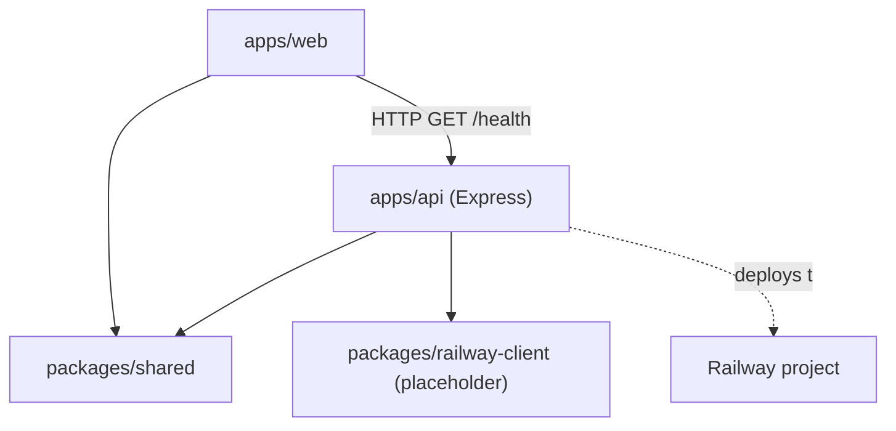

# Implementation Plan — Milestone 1: Project Setup

Scope: only [plan.md](plan.md) Milestone 1. Later milestones get their own implementation plans.

## Goal

A runnable monorepo: React Router v7 frontend + Node.js/TypeScript API + shared packages, connected to a Railway project, with the skeleton deployed and `/health` responding.

## Key Decisions (flag if you disagree)

- **Workspace root** — the current repo (`chaos-eng-demo/`) is the monorepo root; no extra `hotel-chaos-simulator/` nesting.
- **Monorepo tooling** — npm workspaces (built-in, no extra tooling like turbo/pnpm).
- **Frontend** — plain Vite + React + TypeScript SPA (`create-vite` `react-ts` template) with **React Router v7 in declarative/library mode** (`<BrowserRouter>` + `<Routes>` in `src/`, no framework-mode config, no loaders/actions — data fetching via `fetch`). **Tailwind CSS v3** via PostCSS (`tailwindcss`, `postcss`, `autoprefixer`) — standard `@tailwind` directives in CSS, `tailwind.config.ts` content paths for `src/**/*.{ts,tsx}`.
- **Backend** — Express 5 + TypeScript, `tsx` for dev watch, `tsc` for production build, ESM modules.
- **Shared env config** — `packages/shared` exports a zod-validated env loader; each app has its own `.env` + committed `.env.example`.
- **`packages/railway-client`** — scaffolded as an empty typed package now (real GraphQL client is Milestone 4).
- **Ports** — web on `5173`, api on `3001`; CORS restricted to the web origin.

## Target Structure

```text
chaos-eng-demo/
├── apps/
│   ├── web/                  # Vite + React + TS SPA, react-router v7 (library mode)
│   │   ├── src/
│   │   │   ├── pages/
│   │   │   │   └── HomePage.tsx  # placeholder page calling GET /health
│   │   │   ├── App.tsx       # <BrowserRouter> + <Routes>
│   │   │   ├── main.tsx
│   │   │   └── index.css     # @tailwind base/components/utilities
│   │   ├── postcss.config.js
│   │   ├── tailwind.config.ts
│   │   ├── vite.config.ts    # @vitejs/plugin-react only (Tailwind via PostCSS)
│   │   └── package.json
│   ├── api/                  # Node + Express + TS
│   │   ├── src/
│   │   │   ├── index.ts      # entry: express app, cors, /health
│   │   │   └── env.ts        # re-exports shared env parsed for api
│   │   ├── tsconfig.json
│   │   └── package.json
├── packages/
│   ├── shared/
│   │   ├── src/
│   │   │   ├── index.ts
│   │   │   └── env.ts        # zod schema: parseEnv()
│   │   └── package.json      # @hotel-chaos/shared
│   └── railway-client/
│       ├── src/index.ts      # placeholder export
│       └── package.json      # @hotel-chaos/railway-client
├── docs/
├── .env.example
├── .gitignore
├── railway.json              # api service build/start config
├── package.json              # workspaces + root scripts
├── tsconfig.base.json
├── plan.md
└── README.md
```



## Steps

### 1. Root scaffold

- `git init`, `.gitignore` (`node_modules`, `dist`, `.env`, `.railway`).
- Root `package.json`:

```json
{
  "name": "hotel-chaos-simulator",
  "private": true,
  "workspaces": ["apps/*", "packages/*"],
  "scripts": {
    "dev": "concurrently -n web,api \"npm run dev -w apps/web\" \"npm run dev -w apps/api\"",
    "build": "npm run build --workspaces",
    "typecheck": "npm run typecheck --workspaces --if-present"
  },
  "devDependencies": { "concurrently": "^9", "typescript": "~5.8" }
}
```

- `tsconfig.base.json`: `strict`, `ESNext` modules, `bundler` resolution; per-package configs extend it.

### 2. `packages/shared`

- `@hotel-chaos/shared` package, consumed via workspace protocol (`"*"`).
- `src/env.ts` — single zod-based parser both apps use:

```ts
import { z } from "zod";

const envSchema = z.object({
  NODE_ENV: z.enum(["development", "test", "production"]).default("development"),
  PORT: z.coerce.number().default(3001),
  WEB_ORIGIN: z.string().url().default("http://localhost:5173"),
  DATABASE_URL: z.string().optional(),        // Milestone 2
  AUDIT_DATABASE_URL: z.string().optional(),  // Milestone 3
  RAILWAY_API_TOKEN: z.string().optional(),   // Milestone 4
});

export type Env = z.infer<typeof envSchema>;
export const parseEnv = (input: NodeJS.ProcessEnv = process.env): Env =>
  envSchema.parse(input);
```

### 3. `packages/railway-client`

- Empty typed package (`@hotel-chaos/railway-client`) with a placeholder export so the layout matches plan.md; no GraphQL work yet.

### 4. `apps/api`

- Scaffold manually (no generator): Express 5, `tsx watch` dev, `tsc -p tsconfig.json` build to `dist/`.
- `src/index.ts` — minimal server:

```ts
import express from "express";
import cors from "cors";
import { parseEnv } from "@hotel-chaos/shared";

const env = parseEnv();
const app = express();

app.use(cors({ origin: env.WEB_ORIGIN }));
app.use(express.json());

app.get("/health", (_req, res) => {
  res.json({ status: "ok", service: "booking-api", timestamp: new Date().toISOString() });
});

app.listen(env.PORT, () => {
  console.log(`api listening on http://localhost:${env.PORT}`);
});
```

- Scripts: `dev: tsx watch src/index.ts`, `build: tsc`, `start: node dist/index.js`, `typecheck: tsc --noEmit`.
- `apps/api/.env.example`: `PORT=3001`, `WEB_ORIGIN=http://localhost:5173`; load via `dotenv` in dev.

### 5. `apps/web`

- Scaffold with `npm create vite@latest apps/web -- --template react-ts`, then:
  - `npm i react-router` (v7, library mode) — define routes in `src/App.tsx` with `<BrowserRouter>` and `<Routes>`; only route for now is `/` → `HomePage`.
  - Add Tailwind v3 (dev deps: `tailwindcss@3`, `postcss`, `autoprefixer`):
    - `npx tailwindcss init -p` → `tailwind.config.ts` + `postcss.config.js` (or equivalent).
    - `content: ["./index.html", "./src/**/*.{js,ts,jsx,tsx}"]` in `tailwind.config.ts`.
    - `src/index.css`: `@tailwind base;`, `@tailwind components;`, `@tailwind utilities;` (imported from `main.tsx`).
    - Do **not** use `@tailwindcss/vite` or Tailwind v4 `@import "tailwindcss"`.
  - `src/pages/HomePage.tsx`: `useEffect` + `fetch` of `GET /health` from the API, render API status (proves web→api wiring end to end).
  - `VITE_API_URL=http://localhost:3001` in `apps/web/.env.example`.
- Production build is static (`vite build` → `dist/`); no SSR server involved.

### 6. Shared environment configuration

- Root `.env.example` documents all variables; per-app `.env.example` files hold app-local values.
- Convention: apps never read `process.env` directly — always via `parseEnv()` from `@hotel-chaos/shared` (frontend uses `import.meta.env.VITE_*` only).

### 7. Connect to Railway

Agent does: add `railway.json`, docs, verify CLI.

```json
{
  "$schema": "https://railway.com/railway.schema.json",
  "build": { "builder": "NIXPACKS" },
  "deploy": { "startCommand": "node apps/api/dist/index.js", "restartPolicyType": "ON_FAILURE" }
}
```

You do (interactive, need your Railway account — commands documented in README):

1. `npm i -g @railway/cli` then `railway login`.
2. `railway init` → new project `hotel-chaos-simulator`.
3. `railway add --database postgres` → this becomes the **primary DB** (audit DB is added in Milestone 3).
4. Create a service for the API from this repo; set variables `PORT`, `WEB_ORIGIN`.
5. Deploy the API skeleton and verify `GET /health` returns `200` on the Railway URL.
6. (Optional now, required by M2/M5) Add a static-site service for `apps/web` (`vite build` output); for Milestone 1 the local Vite dev server is sufficient to prove web→api wiring.
7. Generate a Railway API token (Account → Tokens) and store it as `RAILWAY_API_TOKEN` — needed by Milestone 4's GraphQL client.
8. Record the project/service/environment IDs in `docs/railway.md` for the Milestone 4 client config.

### 8. Docs

- `README.md`: setup steps, scripts, ports, Railway link instructions.
- `docs/railway.md`: project ID, service IDs, token instructions (placeholders filled in during the Railway step above).

## Verification Checklist (Milestone 1 done when)

- [x] `npm install` at root installs all workspaces cleanly.
- [x] `npm run dev` starts web on `5173` and api on `3001` together.
- [x] Home page renders API status from `GET /health` (web→api wiring proven).
- [x] `npm run typecheck` passes across all workspaces.
- [x] Railway project exists, API skeleton deployed, `GET /health` returns 200 on the public Railway URL.
- [x] Primary Postgres service provisioned in Railway (connection not used until Milestone 2).
- [x] `docs/railway.md` contains project/service IDs and token location.

## Explicitly Out of Scope (later milestones)

- Booking endpoints and database connection (M2), audit DB (M3), Railway GraphQL client implementation (M4), any UI beyond the health-check placeholder.
