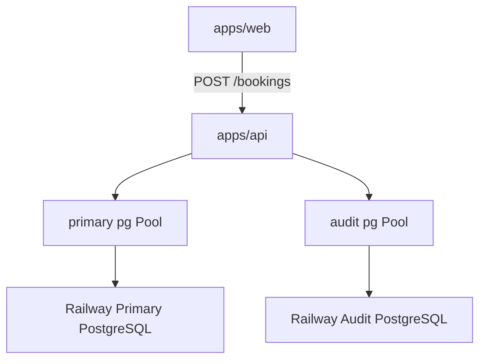

# Implementation Plan — Milestone 3: Audit Event System

Scope: only [plan.md](plan.md) Milestone 3 (Audit Event System). Railway chaos controls, experiments, and timeline UI are later milestones.

## Goal

Durable **audit events** in a **separate PostgreSQL** database, independent of the primary booking database:

```text
React UI → Booking API → Primary PostgreSQL (bookings)
                      ↘ Audit PostgreSQL (audit_events)
```

The audit database must remain writable when the primary database is down (core MVP step 5 in plan.md).

MVP checkpoint from plan.md: a **normal successful booking** produces an **ordered event trail**. M3 also records failure events on the existing `DATABASE_UNAVAILABLE` path from M2.

Event types (plan.md):

```text
REQUEST_RECEIVED
VALIDATION_PASSED
BOOKING_ATTEMPTED
DATABASE_UNAVAILABLE
BOOKING_FAILED
DATABASE_RECOVERED
BOOKING_CREATED
```

Suggested fields: `id`, `eventType`, `requestId`, `bookingId`, `experimentId`, `timestamp`, `metadata`.

## Key Decisions (flag if you disagree)

- **Second Railway Postgres** — provision a distinct audit instance (`railway add --database postgres`). Local dev: `AUDIT_DATABASE_URL` in `apps/api/.env`, typically **`DATABASE_PUBLIC_URL`** from the audit Postgres service (same pattern as M2 primary).
- **Boot requirements** — `AUDIT_DATABASE_URL` required when the API starts (fail fast in `apps/api/src/env.ts`, mirroring `DATABASE_URL`). Keep `AUDIT_DATABASE_URL` optional in shared `parseEnv()` for future web-only tooling.
- **Two pools, two migration tracks** — primary: `apps/api/db/migrations/` + `npm run db:migrate`; audit: `apps/api/db/audit-migrations/` + `npm run db:migrate:audit`. Same runner pattern as [migrate.ts](apps/api/src/db/migrate.ts), driven by `AUDIT_DATABASE_URL`.
- **Shared contracts** — `@hotel-chaos/shared` exports Zod `auditEventTypeSchema`, `auditEventSchema`, `listAuditEventsQuerySchema`, and TypeScript types for API read models.
- **Correlation IDs**
  - **`requestId`** — middleware: honor `X-Request-ID` when it is a valid UUID, else `crypto.randomUUID()`; attach to `req.requestId` and response header `X-Request-ID`.
  - **`eventId`** — audit row UUID primary key; JSON field name **`eventId`** (maps to column `id`).
  - **`bookingId`** — public booking id (`BK-....`) when known; null on early events and on primary-DB failure.
  - **`experimentId`** — nullable column; always `null` in M3 (M6 will set).
- **Event emission on `POST /bookings` only** (M3 checkpoint):

| Step | HTTP | Audit events |
|------|------|----------------|
| Request enters | — | `REQUEST_RECEIVED` |
| Zod fails | 400 | `REQUEST_RECEIVED` only (no new event types) |
| Zod ok | — | `VALIDATION_PASSED` |
| Before insert | — | `BOOKING_ATTEMPTED` |
| Insert ok | 201 | `BOOKING_CREATED` |
| Primary DB down | 503 | `DATABASE_UNAVAILABLE`, then `BOOKING_FAILED` |

- **`DATABASE_RECOVERED`** — included in shared enum and DB; **not emitted automatically in M3** (recovery detection comes with Railway chaos / polling in M4–M6).
- **Audit write failures**
  - **Success path (201):** best-effort — log error; still return 201 if primary insert succeeded.
  - **503 primary-down path:** must attempt audit writes; if audit insert fails, still return 503, log at error level.
- **Health** — extend `GET /health` with `auditDatabase: "up" | "down"` from audit pool `SELECT 1`; HTTP **200** always (liveness, same as M2 `database` field).
- **Read API** — `GET /audit/events` requires at least one of `requestId` or `bookingId`; returns `{ events }` ordered by `timestamp` ascending.
- **Shutdown** — `closeAuditPool()` on SIGTERM alongside primary pool.
- **Web** — no UI changes required for M3 checkpoint.

## Target Structure

```text
chaos-eng-demo/
├── packages/shared/src/
│   ├── audit.ts                    # event types + AuditEvent + list query
│   └── index.ts                    # re-export audit
├── apps/api/
│   ├── db/
│   │   ├── migrations/             # primary (M2)
│   │   └── audit-migrations/
│   │       └── 001_create_audit_events.sql
│   ├── src/
│   │   ├── db/
│   │   │   ├── auditPool.ts
│   │   │   ├── auditMigrate.ts
│   │   │   └── auditEventsRepository.ts
│   │   ├── audit/
│   │   │   └── recordAuditEvent.ts
│   │   ├── middleware/
│   │   │   └── requestId.ts
│   │   ├── routes/
│   │   │   ├── audit.ts
│   │   │   ├── bookings.ts         # instrumented
│   │   │   └── health.ts
│   │   ├── types/
│   │   │   └── express.d.ts
│   │   ├── env.ts                  # require AUDIT_DATABASE_URL
│   │   └── index.ts
│   └── package.json                # db:migrate:audit script
└── docs/railway.md                 # Milestone 3 section
```



## Steps

### 1. Shared audit model (`packages/shared`)

Add `src/audit.ts` and export from `src/index.ts`.

**`auditEventTypeSchema`** — enum of all plan.md event types (including `DATABASE_RECOVERED` for future use).

**`auditEventSchema`** — JSON read model:

| Field | Role |
|-------|------|
| `eventId` | UUID string (row `id`) |
| `eventType` | One of the enum values |
| `requestId` | Correlation id for the HTTP request |
| `bookingId` | Optional public booking id |
| `experimentId` | Optional; null in M3 |
| `timestamp` | ISO string from `created_at` |
| `metadata` | Record string → unknown (from JSONB) |

**`listAuditEventsQuerySchema`** — query for `GET /audit/events`:

- `requestId`: optional UUID string
- `bookingId`: optional string (e.g. `BK-1821`)
- Refine: at least one of `requestId` or `bookingId` must be present (enforced in route if refine is awkward for partial query objects).

**`listAuditEventsResponseSchema`** — `{ events: auditEventSchema[] }`.

### 2. Audit DB schema

`apps/api/db/audit-migrations/001_create_audit_events.sql`:

```sql
CREATE TABLE IF NOT EXISTS audit_events (
  id UUID PRIMARY KEY DEFAULT gen_random_uuid(),
  event_type TEXT NOT NULL,
  request_id TEXT NOT NULL,
  booking_id TEXT,
  experiment_id TEXT,
  metadata JSONB NOT NULL DEFAULT '{}'::jsonb,
  created_at TIMESTAMPTZ NOT NULL DEFAULT now()
);

CREATE INDEX IF NOT EXISTS audit_events_request_id_created_at
  ON audit_events (request_id, created_at);

CREATE INDEX IF NOT EXISTS audit_events_booking_id_created_at
  ON audit_events (booking_id, created_at);
```

**Apply audit migrations**

1. **`.env` on laptop** — copy audit Postgres **`DATABASE_PUBLIC_URL`** into `apps/api/.env` as `AUDIT_DATABASE_URL`, then:

   ```bash
   npm run db:migrate:audit -w api
   ```

2. **CLI with audit Postgres linked:**

   ```bash
   railway link   # audit Postgres service
   railway run npm run db:migrate:audit -w api
   ```

M3 does not add a Railway `releaseCommand`; run audit migrations explicitly once per environment.

### 3. API environment

Extend `apps/api/src/env.ts`:

```ts
if (!parsed.AUDIT_DATABASE_URL) {
  throw new Error("AUDIT_DATABASE_URL is required for the booking API");
}
```

Export `ApiEnv` with both `DATABASE_URL` and `AUDIT_DATABASE_URL` as required strings.

Update `apps/api/.env.example` and root `.env.example` with `AUDIT_DATABASE_URL` placeholder.

**Deployed booking-api** — reference audit Postgres from Railway (e.g. `${{AuditPostgres.DATABASE_URL}}` per service naming in UI).

### 4. Audit database layer

- **`auditPool.ts`** — `Pool` on `env.AUDIT_DATABASE_URL`; `getAuditPool()`, `closeAuditPool()`.
- **`auditMigrate.ts`** — same logic as `migrate.ts` but `AUDIT_DATABASE_URL` and directory `db/audit-migrations/`.
- **`auditEventsRepository.ts`**
  - `insertAuditEvent(input): Promise<AuditEvent>` — insert row, map to shared `AuditEvent`.
  - `listAuditEvents(filters: { requestId?: string; bookingId?: string }): Promise<AuditEvent[]>` — ordered by `created_at ASC`.

### 5. Audit recording helper

**`audit/recordAuditEvent.ts`**

- `recordAuditEvent(params, options?: { critical?: boolean })` — calls repository insert.
- Default: catch errors, `console.error`, do not throw (best-effort).
- When `critical: true` (503 path): same — still do not throw (client gets 503); log at error level.

Types for params: `eventType`, `requestId`, optional `bookingId`, optional `experimentId`, optional `metadata`.

### 6. Request ID middleware

**`middleware/requestId.ts`**

- Parse `X-Request-ID` header; if valid UUID v4 (or generic UUID), use it; else generate new UUID.
- Set `req.requestId` and `res.setHeader("X-Request-ID", requestId)`.

**`types/express.d.ts`** — augment `Express.Request` with `requestId: string`.

Register middleware in `index.ts` before routes (after `express.json()`).

### 7. Instrument `POST /bookings`

In `routes/bookings.ts`:

1. After middleware, first line: `await recordAuditEvent({ eventType: "REQUEST_RECEIVED", requestId: req.requestId })`.
2. On validation failure: return 400 (no further audit events).
3. On success parse: `VALIDATION_PASSED`, then `BOOKING_ATTEMPTED`.
4. On insert success: `BOOKING_CREATED` with `bookingId`; then 201 response.
5. On catch: if `isDatabaseUnavailable(error)`, await `recordAuditEvent` for `DATABASE_UNAVAILABLE` and `BOOKING_FAILED` with `{ critical: true }`; then `next(error)`.

`GET /bookings/:id` unchanged (no audit in M3).

### 8. Audit read route

**`routes/audit.ts`**

- `GET /audit/events` — parse query with shared schema; 400 if neither filter; 200 `{ events }`.

Mount in `index.ts`.

### 9. Health route

Extend `GET /health` response:

```json
{
  "status": "ok",
  "service": "booking-api",
  "timestamp": "...",
  "database": "up",
  "auditDatabase": "up"
}
```

Probe audit pool independently of primary.

### 10. Root scripts and docs

Root `package.json`:

```json
"db:migrate:audit": "npm run db:migrate:audit -w api"
```

**docs/railway.md** — Milestone 3: second Postgres, `AUDIT_DATABASE_URL` on booking-api, run `db:migrate:audit`, verify `auditDatabase` in `/health`.

**README.md** — M3 section: audit env, migrate, curl POST + GET audit trail via `X-Request-ID`.

## Verification Checklist (Milestone 3 done when)

- [ ] Second Postgres on Railway; `AUDIT_DATABASE_URL` on booking-api and in local `apps/api/.env`
- [ ] `npm run db:migrate:audit -w api` applies `001_create_audit_events.sql` without error
- [ ] `GET /health` returns 200 with `"database":"up"` and `"auditDatabase":"up"` when both reachable
- [ ] Successful `POST /bookings` response headers include `X-Request-ID`
- [ ] `GET /audit/events?requestId=<uuid>` returns ordered: `REQUEST_RECEIVED` → `VALIDATION_PASSED` → `BOOKING_ATTEMPTED` → `BOOKING_CREATED`
- [ ] With primary Postgres stopped or invalid `DATABASE_URL`: `POST /bookings` → 503 with `DATABASE_UNAVAILABLE`; audit trail for that `requestId` includes `DATABASE_UNAVAILABLE` and `BOOKING_FAILED` while `auditDatabase` remains `"up"`
- [ ] `GET /audit/events?bookingId=BK-xxxx` returns events for that booking after a successful create
- [ ] `npm run typecheck` passes all workspaces

### curl smoke tests

```bash
API=http://localhost:3001

curl -s "$API/health" | jq .

# Capture request id from response headers
curl -si -X POST "$API/bookings" \
  -H "Content-Type: application/json" \
  -d '{
    "guestName": "Ada Lovelace",
    "email": "ada@example.com",
    "roomId": "101",
    "checkIn": "2026-09-01",
    "checkOut": "2026-09-03"
  }' | tee /tmp/booking-response.txt

REQ=$(grep -i '^x-request-id:' /tmp/booking-response.txt | awk '{print $2}' | tr -d '\r')
curl -s "$API/audit/events?requestId=$REQ" | jq .

# After successful POST, use bookingId from JSON body:
curl -s "$API/audit/events?bookingId=BK-1821" | jq .
```

### SQL spot check

```sql
SELECT event_type, request_id, booking_id, created_at
FROM audit_events
ORDER BY created_at DESC
LIMIT 10;
```

## Explicitly Out of Scope (later milestones)

- Railway GraphQL client, stop/restart database, chaos dashboard (M4–M5)
- `POST /experiments`, experiment state machine, non-null `experimentId` (M6)
- Timeline UI, recovery metrics (M7–M8)
- Railway logs UI (M9)
- Audit events on `GET /bookings/:id`
- Automatic `DATABASE_RECOVERED` emission
- Auth, retention policies, deliberate audit DB outage scenarios
- Web UI changes for audit timeline
