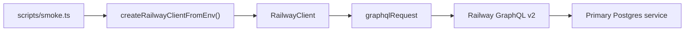

# Implementation Plan — Milestone 4: Railway GraphQL Client

Scope: only [plan.md](plan.md) Milestone 4 (Railway GraphQL Client). Chaos dashboard, experiment endpoints, timeline UI, and recovery metrics are later milestones.

## Goal

A dedicated **Railway integration layer** in `@hotel-chaos/railway-client` that wraps the public GraphQL API. Route handlers and the React app must **never** embed GraphQL strings — they call `RailwayClient` (starting in M5–M6).

```text
(M5+) apps/api routes  →  RailwayClient  →  POST https://backboard.railway.com/graphql/v2
                                              ↓
                                    Primary Postgres service (stop / restart / status)
```

Public interface from plan.md:

```text
RailwayClient
├── getServiceStatus()
├── stopService()
├── restartService()
└── getDeploymentStatus()
```

Initial Railway scope (plan.md):

- Read service status
- Stop the **primary database** service
- Restart the **primary database** service
- Read deployment status

Do **not** add rollback, ephemeral environments, or advanced deployment controls in M4.

MVP checkpoint: with a valid account token and service/environment IDs from [docs/railway.md](docs/railway.md), a **local smoke script** can read status, stop primary Postgres, observe stopped state, restart, and observe running again. Bookings will fail while primary DB is stopped — expected.

## Key Decisions (flag if you disagree)

- **GraphQL endpoint** — `https://backboard.railway.com/graphql/v2` ([Railway Public API](https://docs.railway.com/reference/public-api)).
- **Authentication** — `Authorization: Bearer <token>` using **`RAILWAY_API_TOKEN`** (account token from [Account → Tokens](https://railway.com/account/tokens)); same token already documented for booking-api in [docs/railway.md](docs/railway.md).
- **Config via env** — optional fields on shared `parseEnv()`; required only when constructing the client:
  - `RAILWAY_API_TOKEN` (required for client)
  - `RAILWAY_ENVIRONMENT_ID` (required for stop/restart and deployment queries)
  - `RAILWAY_PRIMARY_DB_SERVICE_ID` (default target for all four methods)
  - `RAILWAY_PROJECT_ID` (optional in M4; useful for future project-scoped queries in M6+)
- **IDs** — use values already recorded in [docs/railway.md](docs/railway.md) `#ids-and-urls` (e.g. Environment ID `82352c2f-71f9-4a39-93bb-175924d93388`, Primary Postgres service ID `c9a59b73-4469-41b2-87a5-a5f0791ba1a6`). Do not commit tokens.
- **API boot** — **Do not** require `RAILWAY_API_TOKEN` in `apps/api/src/env.ts` in M4. Booking API keeps working without Railway env until M5 wires routes. Token is required only when `createRailwayClientFromEnv()` runs (smoke script or later routes).
- **No new HTTP routes in M4** — no `/infrastructure/*`, no dashboard polling API (M5), no `POST /experiments` (M6).
- **Stop/restart semantics** — operate on the **service instance** for `(environmentId, serviceId)` using Railway dashboard-equivalent mutations. Exact mutation names and input shapes should be confirmed during implementation via [GraphiQL](https://railway.com/graphiql) or the dashboard Network tab (Railway’s recommended workflow). Expected operations: **`serviceInstanceStop`** and **`serviceInstanceRestart`** with `environmentId` + `serviceId`.
- **Normalized lifecycle** — `getServiceStatus()` returns a status enum aligned with plan.md M5 dashboard states: `RUNNING`, `STOPPING`, `STOPPED`, `STARTING`, `FAILED`, plus `rawDeploymentStatus` (Railway enum string) for debugging.
- **Deployment mapping** — map Railway deployment statuses (`SUCCESS`, `BUILDING`, `DEPLOYING`, `CRASHED`, `FAILED`, `REMOVED`, `SLEEPING`, etc.) in one module; document edge cases in code comments only where non-obvious.
- **`getDeploymentStatus()`** — latest deployment for the service in the configured environment: `deploymentId`, `status`, `createdAt` (ISO string).
- **Errors** — export `RailwayClientError` with `message`, optional GraphQL `errors[]`, optional HTTP status. No automatic retries in the client except an optional **poll helper** used by the smoke script (not exported as general retry policy).
- **HTTP client** — native `fetch` (Node ≥ 20, already enforced at repo root). No `graphql-request` dependency unless introspection tooling needs it later.
- **Build** — implement in `packages/railway-client`; ensure `npm run typecheck` includes the workspace. When M5 adds `@hotel-chaos/railway-client` as an API dependency, extend root `build:api` to build railway-client before `api` (not required for M4 checkpoint if API does not import the package yet).
- **Safety** — smoke script defaults to **status-only**; full stop/restart cycle requires an explicit flag. Document that stopping primary Postgres breaks `POST /bookings` until restart.

## Target Structure

```text
chaos-eng-demo/
├── packages/railway-client/
│   ├── src/
│   │   ├── index.ts                 # RailwayClient, types, createRailwayClientFromEnv
│   │   ├── RailwayClient.ts
│   │   ├── config.ts                # RailwayClientConfig, loadFromEnv()
│   │   ├── graphqlRequest.ts        # POST + parse { data, errors }
│   │   ├── mapDeploymentStatus.ts   # Railway → ServiceLifecycleStatus
│   │   ├── errors.ts
│   │   └── operations/
│   │       ├── deployments.ts       # query latest deployment / instance
│   │       └── serviceInstance.ts   # stop + restart mutations
│   ├── scripts/
│   │   └── smoke.ts                 # tsx entry: status-only or full cycle
│   └── package.json                 # "smoke" script; devDep tsx if needed
├── packages/shared/src/env.ts       # optional RAILWAY_* ID fields
├── .env.example                     # commented RAILWAY_* vars
├── apps/api/.env.example            # same IDs for local smoke (loads apps/api/.env)
└── docs/railway.md                  # Milestone 4 section (when implementing)
```

Remove the M1 placeholder from `packages/railway-client/src/index.ts` (`RAILWAY_CLIENT_NOT_IMPLEMENTED`).



## Steps

### 1. Shared environment (optional Railway IDs)

Extend `packages/shared/src/env.ts`:

```ts
RAILWAY_PROJECT_ID: z.string().optional(),
RAILWAY_ENVIRONMENT_ID: z.string().optional(),
RAILWAY_PRIMARY_DB_SERVICE_ID: z.string().optional(),
// RAILWAY_API_TOKEN already optional from M1
```

Update root `.env.example` and `apps/api/.env.example` with commented placeholders (no secrets), pointing to [docs/railway.md](docs/railway.md) for real IDs.

**Do not** extend `apps/api/src/env.ts` to require these in M4.

### 2. Package layout and types

**`config.ts`**

```ts
export type RailwayClientConfig = {
  apiToken: string;
  environmentId: string;
  primaryDbServiceId: string;
  projectId?: string;
};

export const loadRailwayConfigFromEnv = (
  input: NodeJS.ProcessEnv = process.env
): RailwayClientConfig => { /* throw if token / environmentId / primaryDbServiceId missing */ };
```

**Exported types** (from `index.ts`):

- `ServiceLifecycleStatus` — `RUNNING` | `STOPPING` | `STOPPED` | `STARTING` | `FAILED`
- `ServiceStatusResult` — `{ serviceId, environmentId, status, rawDeploymentStatus, deploymentId?: string }`
- `DeploymentStatusResult` — `{ deploymentId, status, createdAt, serviceId, environmentId }`

**`RailwayClient` class** — constructor takes `RailwayClientConfig`; methods accept optional `serviceId` override defaulting to `primaryDbServiceId`.

### 3. GraphQL transport (`graphqlRequest.ts`)

- `postGraphQL<TData>(options: { apiToken, query, variables? }): Promise<TData>`
- Headers: `Authorization: Bearer …`, `Content-Type: application/json`
- Body: `{ query, variables }`
- Parse JSON; if `errors?.length`, throw `RailwayClientError`
- Use `AbortSignal.timeout(30_000)` on fetch
- Do not log token values

### 4. GraphQL operations (`operations/`)

Keep all query/mutation strings here. During implementation, verify field names against GraphiQL introspection.

**Deployments / status (read)**

Purpose: fetch enough data for `getServiceStatus` and `getDeploymentStatus` — typically the **latest deployment** (or service instance node) for `serviceId` in `environmentId`. Railway’s schema may expose this via a `deployments` connection filtered by service/environment, or via `service` → `serviceInstances` → `latestDeployment`. Use the shape the dashboard uses (Network tab).

Suggested variables:

```ts
{ environmentId: string; serviceId: string }
```

**Stop / restart (write)**

Mutations (names to confirm in GraphiQL):

- Stop: `serviceInstanceStop(environmentId, serviceId)` (or documented equivalent)
- Restart: `serviceInstanceRestart(environmentId, serviceId)` (or documented equivalent)

Return type: treat mutation success as resolved Promise; surface GraphQL errors as `RailwayClientError`.

### 5. Status mapping (`mapDeploymentStatus.ts`)

Single function, e.g. `toLifecycleStatus(railwayStatus: string): ServiceLifecycleStatus`:

| Railway deployment status (examples) | Normalized |
|--------------------------------------|------------|
| `SUCCESS` | `RUNNING` |
| `BUILDING`, `DEPLOYING`, `QUEUED`, `WAITING` | `STARTING` or `STOPPING` (pick one rule: deploying after restart → `STARTING`; optional refine in M5 polling) |
| `REMOVED`, `SLEEPING` | `STOPPED` |
| `CRASHED`, `FAILED` | `FAILED` |

Document in M4 implementation if `STOPPING` cannot be distinguished from Railway alone — polling after `stopService()` may treat in-flight states as `STOPPING` until `STOPPED`.

### 6. `RailwayClient` methods

**`getServiceStatus(serviceId?)`**

1. Resolve `serviceId` (default primary).
2. Run deployment/status query.
3. Map to `ServiceStatusResult`.

**`getDeploymentStatus(serviceId?)`**

1. Same query or a focused deployment query.
2. Return latest deployment fields without forcing lifecycle mapping (include raw `status`).

**`stopService(serviceId?)`**

1. Invoke stop mutation.
2. No polling inside the method (callers/smoke script poll `getServiceStatus`).

**`restartService(serviceId?)`**

1. Invoke restart mutation.
2. No polling inside the method.

### 7. Factory export

**`createRailwayClientFromEnv()`** in `index.ts`:

- Calls `loadRailwayConfigFromEnv()`
- Returns `new RailwayClient(config)`

### 8. Smoke script (`packages/railway-client/scripts/smoke.ts`)

Load env from `apps/api/.env` (via `dotenv` path relative to repo root) so local dev matches API secrets location.

**CLI behavior:**

| Mode | Flag | Behavior |
|------|------|----------|
| Default | (none) | Print `getServiceStatus` + `getDeploymentStatus` for primary Postgres; exit 0 |
| Full cycle | `--execute-stop-restart` | Stop → poll until `STOPPED` (max e.g. 120s, interval 5s) → restart → poll until `RUNNING` |

Print normalized status and raw deployment status each poll.

**Root `package.json` script (when implementing):**

```json
"railway:smoke": "npm run smoke -w @hotel-chaos/railway-client"
```

**`packages/railway-client/package.json`:**

```json
"smoke": "tsx scripts/smoke.ts"
```

Add `tsx` as devDependency on railway-client if not hoisted.

### 9. Documentation updates (when implementing M4 code — listed here for completeness)

**docs/railway.md** — add **Milestone 4** section:

- Confirm `RAILWAY_API_TOKEN` on booking-api (for future M5 server-side calls)
- Local env vars for IDs + token
- Run `npm run railway:smoke` (status-only)
- Warning: `--execute-stop-restart` stops primary DB; bookings return 503 until restart; audit DB should stay up

**README.md** — replace “Placeholder (Milestone 4)” with link to this file and smoke command.

## Verification Checklist (Milestone 4 done when)

- [ ] `packages/railway-client` exports `RailwayClient`, `createRailwayClientFromEnv`, types, and `RailwayClientError`; placeholder export removed
- [ ] `npm run typecheck` passes all workspaces
- [ ] `RAILWAY_API_TOKEN`, `RAILWAY_ENVIRONMENT_ID`, and `RAILWAY_PRIMARY_DB_SERVICE_ID` set locally (not in git)
- [ ] Status-only smoke prints sensible `ServiceStatusResult` for primary Postgres (typically `RUNNING` when healthy)
- [ ] Full-cycle smoke (`--execute-stop-restart`): status transitions to stopped, then back to running within timeout
- [ ] During stopped window: `POST /bookings` → 503 with `DATABASE_UNAVAILABLE`; audit trail still writable (`GET /health` shows `auditDatabase: "up"`)
- [ ] After restart: successful booking again
- [ ] No GraphQL query/mutation strings under `apps/api/src/routes` or `apps/web`
- [ ] No new Express routes added in M4

### Smoke commands

```bash
# From repo root — status only (safe)
npm run railway:smoke

# Full chaos cycle on primary Postgres (disrupts bookings)
npm run railway:smoke -- --execute-stop-restart
```

### Booking verification during outage (reuse M2/M3 patterns)

```bash
API=http://localhost:3001   # or deployed public URL

curl -s "$API/health" | jq .

curl -si -X POST "$API/bookings" \
  -H "Content-Type: application/json" \
  -d '{
    "guestName": "Test Guest",
    "email": "test@example.com",
    "roomId": "101",
    "checkIn": "2026-09-01",
    "checkOut": "2026-09-03"
  }'
# Expect 503 + DATABASE_UNAVAILABLE while primary DB is stopped
```

## Explicitly Out of Scope (later milestones)

- Chaos control dashboard UI and infrastructure polling API (M5)
- `POST /experiments`, experiment state machine, non-null `experimentId` on audit events (M6)
- Automatic `DATABASE_RECOVERED` audit emission (M6+)
- Experiment timeline UI, recovery metrics (M7–M8)
- Railway logs correlation UI (M9)
- Rollback, redeploy-to-specific-image, ephemeral environments, multi-environment provisioning
- Stopping audit Postgres or booking-api via this client (M4 defaults target primary DB only; optional `serviceId` param reserved for M5 multi-service dashboard)
- Auth on any Railway-facing HTTP endpoints
- Rate-limit handling beyond surfacing errors (Railway documents RPH/RPS limits on Public API)
