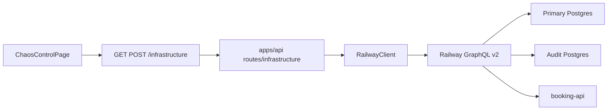

# Implementation Plan — Milestone 5: Chaos Control Dashboard

Scope: only [plan.md](plan.md) Milestone 5 (Chaos Control Dashboard). Experiment orchestration, timeline UI, and recovery metrics are later milestones.

## Goal

An **infrastructure control screen** that reads Railway lifecycle for three services and can stop/restart the **primary database** through the Booking API (which wraps `@hotel-chaos/railway-client`). Route handlers and the React app still **never** embed GraphQL strings ([plan.md](plan.md) M4; [IMPLEMENTATION_MILESTONE_4.md](IMPLEMENTATION_MILESTONE_4.md)).

```text
HOTEL CHAOS SIMULATOR

Primary DB
● RUNNING

[ Stop Database ]  [ Restart Database ]

Audit DB
● RUNNING

Booking API
● RUNNING
```

Support infrastructure states from plan.md:

```text
RUNNING
STOPPING
STOPPED
STARTING
FAILED
```

The dashboard must **poll or refresh** Railway state after lifecycle operations.

MVP checkpoint: from the web UI you can see Primary DB / Audit DB / Booking API status, stop the primary database, watch it go `STOPPING` → `STOPPED`, confirm bookings return `DATABASE_UNAVAILABLE`, restart the primary database, watch it go `STARTING` → `RUNNING`, and book successfully again. Audit DB and Booking API remain status-only (no stop/restart buttons).

```text
ChaosControlPage
   ↓  GET /infrastructure  (poll)
   ↓  POST /infrastructure/primary-db/stop | restart
Booking API
   ↓  RailwayClient.getServiceStatus / stopService / restartService
Railway GraphQL
   ↓
Primary Postgres  |  Audit Postgres  |  booking-api
```

## Key Decisions (flag if you disagree)

- **API owns RailwayClient** — M4 already specified `(M5+) apps/api routes → RailwayClient` and “When M5 adds `@hotel-chaos/railway-client` as an **API** dependency”. The browser never holds `RAILWAY_API_TOKEN`. Web talks HTTP to the Booking API only.
- **HTTP contract in `@hotel-chaos/shared`** — inferred from M2/M3 (booking and audit DTOs live in shared so web and API stay aligned) plus M1’s `web → shared` / `api → railway-client` graph. **Web must not depend on `@hotel-chaos/railway-client`.** New Zod schemas + types in `packages/shared/src/infrastructure.ts`. `apps/web` keeps depending only on `@hotel-chaos/shared`.
- **No GraphQL in routes or UI** — explicit in plan.md M4. API maps `RailwayClient` results onto the shared HTTP types.
- **Mutations: primary DB only** — plan.md’s mock shows `[ Stop Database ]` only on Primary DB. Audit DB and Booking API are **status-only**. Stopping booking-api would take down the dashboard’s API; stopping audit would violate M3 (“audit database must stay available when the primary database is down”). Include **Restart** for primary DB so recovery does not require `npm run railway:smoke -- --execute-stop-restart`.
- **Endpoints**
  - `GET /infrastructure` — status for `primary-db`, `audit-db`, `booking-api`
  - `POST /infrastructure/primary-db/stop`
  - `POST /infrastructure/primary-db/restart`
- **Railway env required for API boot in M5** — `apps/api/src/env.ts` requires `RAILWAY_API_TOKEN`, `RAILWAY_ENVIRONMENT_ID`, `RAILWAY_PRIMARY_DB_SERVICE_ID`, `RAILWAY_AUDIT_DB_SERVICE_ID`, `RAILWAY_API_SERVICE_ID` (same fail-fast pattern as `DATABASE_URL`). Keep them optional in shared `parseEnv()`. `RAILWAY_PROJECT_ID` stays optional.
- **Audit Postgres service ID** — not in [docs/railway.md](docs/railway.md) `#ids-and-urls` today. Look it up (`railway status` / dashboard) and record it when implementing.
- **`STOPPING` / `STARTING` overlay** — Railway has no distinct `STOPPING` deployment status ([packages/railway-client/src/mapDeploymentStatus.ts](packages/railway-client/src/mapDeploymentStatus.ts)). After a successful stop POST, the UI treats primary as `STOPPING` until poll returns `STOPPED` or `FAILED`. After restart, treat as `STARTING` until `RUNNING` or `FAILED`. Do not change `toLifecycleStatus` in M5 unless a real Railway status is discovered.
- **Polling** — TanStack Query `refetchInterval` ~3s on `GET /infrastructure`; ~1s while a stop/restart is in flight. Manual refresh button is optional, not required.
- **Nav** — shared header with links to booking (`/`) and chaos (`/chaos`). Existing booking routes keep working.
- **No auth** — MVP out of scope ([plan.md](plan.md)). Document that `/infrastructure` mutations are unauthenticated.
- **Health vs Railway** — `GET /health` stays a SQL `SELECT 1` probe (`database` / `auditDatabase` up/down). For **primary-db** and **audit-db**, `GET /infrastructure` `status` uses that same probe (liveness). `rawDeploymentStatus` is Railway’s latest deployment record and can stay `SUCCESS` after `deploymentStop`. `booking-api` still uses Railway lifecycle only. See **Known behavior** below.
- **Build** — root `build:api` must build `@hotel-chaos/railway-client` before `api`.
- **No new GraphQL operations** — `getServiceStatus(serviceId?)` already accepts an optional service ID. Pass audit and API service IDs from env; default remains primary DB.

### Known behavior (discovered during M5)

**Railway deploy status ≠ container liveness.** `deploymentStop` stops the Postgres container, but `serviceInstance.latestDeployment.status` (and the `deployments` connection’s newest node) often remain `SUCCESS`. Railway’s own dashboard can show the service Online/Active while deploy logs say “Stopping Container”. [Railway healthchecks](https://docs.railway.com/deployments/healthchecks) are deploy-time HTTP checks, not continuous monitoring, and Postgres has no HTTP `/health`. So DB cards compose: probe up → `RUNNING`; probe down + building/deploying → `STARTING`; probe down + crashed/failed → `FAILED`; probe down otherwise (including Railway `SUCCESS`) → `STOPPED`. A Promise.race query timeout around `pool.query` leaked hung clients and falsely marked audit down; use `connectionTimeoutMillis` on the pools instead.

**Audit writes are best-effort; the audit table is not a failure log when audit itself is down.** `recordAuditEvent` swallows insert errors (`audit write failed` / `critical audit write failed` on stdout). A dead audit DB must not fail a booking if primary insert succeeds (201). `BOOKING_FAILED` / `DATABASE_UNAVAILABLE` are only written when `insertBooking` throws and `isDatabaseUnavailable` is true — and those rows go to the **audit** DB, so they never appear if audit is unreachable. `isDatabaseUnavailable` treats `node-pg` disconnects with no `error.code` (`Connection terminated unexpectedly` / `connection timeout`) as 503. M3 assumed audit stays up when primary is down; the inverse is out of scope.

## Target Structure

```text
chaos-eng-demo/
├── packages/shared/src/
│   ├── infrastructure.ts          # NEW: lifecycle enum, service keys, HTTP DTOs
│   ├── env.ts                     # RAILWAY_AUDIT_DB_SERVICE_ID, RAILWAY_API_SERVICE_ID
│   └── index.ts                   # re-export infrastructure
├── apps/api/
│   ├── src/
│   │   ├── railway.ts             # NEW: singleton createRailwayClientFromEnv()
│   │   ├── env.ts                 # require Railway token + five IDs
│   │   ├── errors.ts              # map RailwayClientError → 502 RAILWAY_UNAVAILABLE
│   │   ├── routes/
│   │   │   └── infrastructure.ts  # NEW: GET /infrastructure, POST stop/restart
│   │   └── index.ts               # mount infrastructureRouter
│   └── package.json               # add @hotel-chaos/railway-client
├── apps/web/src/
│   ├── components/
│   │   └── AppHeader.tsx          # NEW: Book | Chaos Control
│   ├── pages/
│   │   └── ChaosControlPage.tsx   # NEW
│   ├── lib/api.ts                 # getInfrastructure, stopPrimaryDb, restartPrimaryDb
│   └── App.tsx                    # /chaos route + header
├── package.json                   # build:api includes railway-client
├── .env.example
├── apps/api/.env.example
├── docs/railway.md                # Milestone 5 + audit Postgres service ID
└── README.md
```



## Steps

### 1. Shared env fields

Extend [packages/shared/src/env.ts](packages/shared/src/env.ts) with optional:

```ts
RAILWAY_AUDIT_DB_SERVICE_ID: z.string().optional(),
RAILWAY_API_SERVICE_ID: z.string().optional(),
```

Existing optional fields stay: `RAILWAY_API_TOKEN`, `RAILWAY_PROJECT_ID`, `RAILWAY_ENVIRONMENT_ID`, `RAILWAY_PRIMARY_DB_SERVICE_ID`.

Update root [`.env.example`](.env.example) and [apps/api/.env.example](apps/api/.env.example) with commented placeholders (no secrets). Point to [docs/railway.md](docs/railway.md) for real IDs.

### 2. Shared HTTP contract (`packages/shared/src/infrastructure.ts`)

Export Zod schemas and inferred types. Re-export from [packages/shared/src/index.ts](packages/shared/src/index.ts).

```ts
export const serviceLifecycleStatusSchema = z.enum([
  "RUNNING",
  "STOPPING",
  "STOPPED",
  "STARTING",
  "FAILED",
]);

export const infrastructureServiceKeySchema = z.enum([
  "primary-db",
  "audit-db",
  "booking-api",
]);

export const infrastructureServiceStatusSchema = z.object({
  key: infrastructureServiceKeySchema,
  label: z.string(),
  serviceId: z.string(),
  status: serviceLifecycleStatusSchema,
  rawDeploymentStatus: z.string(),
  deploymentId: z.string().optional(),
  actions: z.array(z.enum(["stop", "restart"])),
});

export const infrastructureStatusResponseSchema = z.object({
  environmentId: z.string(),
  services: z.array(infrastructureServiceStatusSchema),
});
```

Types: `ServiceLifecycleStatus`, `InfrastructureServiceKey`, `InfrastructureServiceStatus`, `InfrastructureStatusResponse`.

`actions` is empty for `audit-db` and `booking-api`; `["stop", "restart"]` for `primary-db` so the UI does not hard-code which buttons exist.

Do **not** import `@hotel-chaos/railway-client` from shared. API maps `ServiceStatusResult.status` onto the shared enum (same string union already used in the client).

### 3. API env and Railway singleton

**[apps/api/src/env.ts](apps/api/src/env.ts)** — after `parseEnv()`, require:

- existing: `DATABASE_URL`, `AUDIT_DATABASE_URL`
- new: `RAILWAY_API_TOKEN`, `RAILWAY_ENVIRONMENT_ID`, `RAILWAY_PRIMARY_DB_SERVICE_ID`, `RAILWAY_AUDIT_DB_SERVICE_ID`, `RAILWAY_API_SERVICE_ID`

Narrow `ApiEnv` accordingly. Fail fast with a clear message if any are missing (same style as `"DATABASE_URL is required for the booking API"`).

**[apps/api/src/railway.ts](apps/api/src/railway.ts)** — `export const railwayClient = createRailwayClientFromEnv()`. Construct once at module load (env already validated).

**[apps/api/package.json](apps/api/package.json)** — add `"@hotel-chaos/railway-client": "*"`.

**Root [package.json](package.json)** — change `build:api`:

```json
"build:api": "npm run build -w @hotel-chaos/shared && npm run build -w @hotel-chaos/railway-client && npm run build -w api"
```

### 4. Map Railway errors

In [apps/api/src/errors.ts](apps/api/src/errors.ts), detect `RailwayClientError` (import from `@hotel-chaos/railway-client`) and respond **502**:

```json
{ "code": "RAILWAY_UNAVAILABLE", "message": "..." }
```

Use the error’s `message`; do not leak the API token. Leave the existing `DATABASE_UNAVAILABLE` 503 path unchanged.

### 5. Infrastructure routes

**[apps/api/src/routes/infrastructure.ts](apps/api/src/routes/infrastructure.ts)**

Helper: resolve env service IDs to keys:

| key | env | label | actions |
|-----|-----|-------|---------|
| `primary-db` | `RAILWAY_PRIMARY_DB_SERVICE_ID` | `Primary DB` | `stop`, `restart` |
| `audit-db` | `RAILWAY_AUDIT_DB_SERVICE_ID` | `Audit DB` | none |
| `booking-api` | `RAILWAY_API_SERVICE_ID` | `Booking API` | none |

**`GET /infrastructure`**

1. `Promise.all` of `railwayClient.getServiceStatus(serviceId)` for the three IDs.
2. Map each `ServiceStatusResult` to `InfrastructureServiceStatus` (shared type).
3. Return `{ environmentId, services }` — stable order: primary-db, audit-db, booking-api.
4. On `RailwayClientError`, `next(error)` (502 via error handler). Partial failure: if one of three status calls fails, fail the whole GET (simpler than mixed 200 + error slots).

**`POST /infrastructure/primary-db/stop`**

1. Call `railwayClient.stopService(env.RAILWAY_PRIMARY_DB_SERVICE_ID)` (or omit id — default is already primary).
2. Return **202** `{ key: "primary-db", action: "stop" }` (status is not yet `STOPPED`; client polls GET).
3. Never accept a body `serviceId` that could target audit or API.

**`POST /infrastructure/primary-db/restart`**

Same pattern with `restartService`. **202** `{ key: "primary-db", action: "restart" }`.

Reject `POST /infrastructure/audit-db/*` and `POST /infrastructure/booking-api/*` if someone adds them — do not implement those routes.

Mount in [apps/api/src/index.ts](apps/api/src/index.ts) next to the other routers:

```ts
app.use(infrastructureRouter);
```

### 6. Web API helpers

Extend [apps/web/src/lib/api.ts](apps/web/src/lib/api.ts):

```ts
getInfrastructure(): Promise<InfrastructureStatusResponse>
stopPrimaryDb(): Promise<{ key: "primary-db"; action: "stop" }>
restartPrimaryDb(): Promise<{ key: "primary-db"; action: "restart" }>
```

Import types from `@hotel-chaos/shared`. Reuse `requestJson`. Optionally add `auditDatabase` to the local `HealthResponse` type so it matches `GET /health` (M3 already returns it); not required for the chaos page.

**Do not** add `@hotel-chaos/railway-client` to [apps/web/package.json](apps/web/package.json).

### 7. App header and route

**[apps/web/src/components/AppHeader.tsx](apps/web/src/components/AppHeader.tsx)**

- Brand: `Hotel Chaos Simulator`
- Nav: `Book` → `/`, `Chaos Control` → `/chaos`
- `NavLink` with visible current-route state (`aria-current="page"`)
- Keyboard-accessible links (native `<a>` via React Router)

Wrap pages in [apps/web/src/App.tsx](apps/web/src/App.tsx):

```ts
<Route path="/" element={<BookingPage />} />
<Route path="/bookings/:bookingId" element={<BookingDetailsPage />} />
<Route path="/chaos" element={<ChaosControlPage />} />
```

Render `AppHeader` above `<Routes>` (or inside each page — prefer once above Routes so details page also has nav). Keep existing `<main>` max-width patterns on each page; header can be full width with inner `max-w-lg` or `max-w-xl` to match booking.

### 8. Chaos Control page

**[apps/web/src/pages/ChaosControlPage.tsx](apps/web/src/pages/ChaosControlPage.tsx)**

Follow [BookingPage.tsx](apps/web/src/pages/BookingPage.tsx) patterns: named `const` export, Tailwind only, `useQuery`, `handle*` handlers, `useId` for a11y.

**Read**

- `useQuery({ queryKey: ["infrastructure"], queryFn: getInfrastructure, refetchInterval })`
- `refetchInterval`: 1000ms while `pendingAction !== null`, else 3000ms
- Loading: pulse skeletons (same as details page)
- Error: `ApiError` with `code === "RAILWAY_UNAVAILABLE"` → amber/red alert + retry

**Pending overlay (primary only)**

```ts
type PendingAction = "stop" | "restart" | null
```

After `stopPrimaryDb()` succeeds, set `pendingAction` to `"stop"`. Displayed status for primary:

- if `pendingAction === "stop"` and server status is not yet `STOPPED` or `FAILED` → show `STOPPING`
- if `pendingAction === "restart"` and server status is not yet `RUNNING` or `FAILED` → show `STARTING`
- else show server `status`; clear `pendingAction` when a terminal state for that action arrives

**Each service card**

- Label, status dot + text (`RUNNING` emerald, `STOPPING`/`STARTING` amber, `STOPPED` slate, `FAILED` red)
- Optional `rawDeploymentStatus` in `font-mono` at `text-xs` for debugging
- Primary: `Stop Database` / `Restart Database` from `actions`
  - Disable Stop unless displayed status is `RUNNING` (or `FAILED` if you want a way out — prefer disable unless `RUNNING`)
  - Disable Restart unless displayed status is `STOPPED` or `FAILED`
  - Disable both while `pendingAction !== null` or mutation in flight
- Confirm before Stop: `window.confirm` is enough (“Stopping the primary database will make bookings fail until you restart it.”)
- `aria-label` on buttons, `aria-live="polite"` on the status region

**Copy**

- Short warning that Stop targets Railway primary Postgres and bookings will 503 until Restart
- Do not mention experiments (M6)

**Booking page**

- Add a line or rely on the header so users can reach `/chaos` from `/`. No other booking-flow changes required.

### 9. Documentation (when implementing M5 code)

**[docs/railway.md](docs/railway.md)**

- Add **Audit Postgres service ID** to `#ids-and-urls` (look up during implementation).
- Add **Milestone 5** section:
  - Railway vars now required on **booking-api** and in `apps/api/.env` for local API boot
  - `GET /infrastructure` and POST stop/restart
  - Warning: unauthenticated mutations; stopping primary DB breaks bookings
  - Dashboard at `http://localhost:5173/chaos`

**[README.md](README.md)**

- Milestone 5 section: link this file, `/chaos` route, required `RAILWAY_*` vars, note that `build:api` now includes railway-client.

Set the new IDs on the **deployed** booking-api service as well as local `.env`, or the deployed API will fail to boot after M5.

## Verification Checklist (Milestone 5 done when)

- [ ] `npm run typecheck` passes all workspaces
- [ ] `build:api` builds shared → railway-client → api
- [ ] API does not start without Railway token + environment + three service IDs
- [ ] `GET /infrastructure` returns three services in order with lifecycle statuses (typically `RUNNING` when healthy)
- [ ] `POST /infrastructure/primary-db/stop` then poll GET until primary is `STOPPED` (or overlay shows `STOPPING` then `STOPPED`)
- [ ] During stopped window: `POST /bookings` → 503 `DATABASE_UNAVAILABLE`; `GET /health` can show `database: "down"` and `auditDatabase: "up"`
- [ ] `POST /infrastructure/primary-db/restart` then poll until primary is `RUNNING`
- [ ] After restart: successful booking again
- [ ] Audit DB and Booking API cards have **no** stop/restart buttons
- [ ] No GraphQL strings under `apps/api/src/routes` or `apps/web`
- [ ] `apps/web/package.json` does not list `@hotel-chaos/railway-client`
- [ ] `/chaos` reachable from header; `/` booking form still works
- [ ] Audit Postgres service ID recorded in `docs/railway.md`

### Local commands

```bash
# Env: copy IDs into apps/api/.env (token + environment + three service IDs)

npm run dev
# Web: http://localhost:5173/chaos
# API: http://localhost:3001

API=http://localhost:3001

curl -s "$API/infrastructure" | jq .

curl -si -X POST "$API/infrastructure/primary-db/stop"
# poll until STOPPED
curl -s "$API/infrastructure" | jq '.services[] | {key, status, rawDeploymentStatus}'

curl -si -X POST "$API/bookings" \
  -H "Content-Type: application/json" \
  -d '{
    "guestName": "Test Guest",
    "email": "test@example.com",
    "roomId": "101",
    "checkIn": "2026-09-01",
    "checkOut": "2026-09-03"
  }'
# Expect 503 + DATABASE_UNAVAILABLE

curl -si -X POST "$API/infrastructure/primary-db/restart"
# poll until RUNNING, then POST /bookings again → 201
```

## Explicitly Out of Scope (later milestones)

- `POST /experiments`, experiment state machine, non-null `experimentId` on audit events (M6)
- Automatic `DATABASE_RECOVERED` audit emission (M6+)
- Experiment timeline UI (M7)
- Recovery metrics (M8)
- Railway logs correlation UI (M9)
- Stop/restart of Audit DB or Booking API
- Auth on `/infrastructure` (or any) endpoints
- Changing `toLifecycleStatus` unless a real Railway `STOPPING` status is confirmed
- Rollback, ephemeral environments, multi-environment provisioning
- Rate-limit handling beyond surfacing `RAILWAY_UNAVAILABLE`
