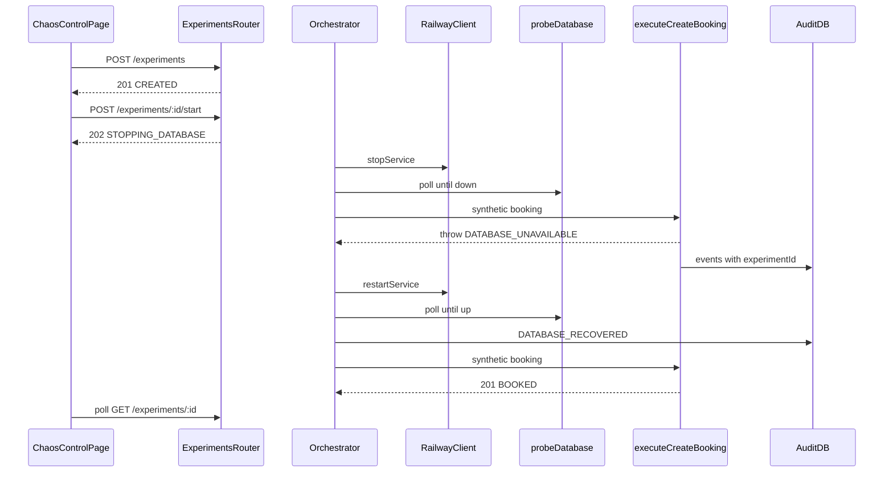

# Implementation Plan — Milestone 6: Database Outage Experiment

Scope: only [plan.md](plan.md) Milestone 6 (Database Outage Experiment). Timeline UI, recovery metrics, and Railway logs are later milestones.

This document is the implementation plan. It does not implement the experiment yet.

## Goal

The first **controlled chaos scenario**: a fully automated database-outage experiment. `POST /experiments/:id/start` runs the whole sequence server-side. The client polls `GET /experiments/:id`.

Scenario from plan.md:

```text
1. Create experiment
2. Stop primary database
3. Wait for stopped state
4. Submit booking
5. Capture DATABASE_UNAVAILABLE
6. Record audit events
7. Restart database
8. Wait for recovery
9. Submit booking again
10. Confirm success
11. Finish experiment
```

Suggested experiment states (plan.md):

```text
CREATED
STOPPING_DATABASE
DATABASE_DOWN
GENERATING_FAILURE
RECOVERING_DATABASE
DATABASE_RECOVERED
VERIFYING_RECOVERY
COMPLETED
FAILED
```

Suggested endpoints (plan.md):

```text
POST /experiments
POST /experiments/:id/start
GET  /experiments/:id
GET  /experiments/:id/events
```

MVP checkpoint: from `/chaos` (or curl) you can create and start an experiment, watch it move through those states, see a 503 booking while the primary DB is down, see a 201 booking after recovery, and list audit events for that `experimentId` including `DATABASE_UNAVAILABLE`, `BOOKING_FAILED`, `DATABASE_RECOVERED`, and `BOOKING_CREATED`.

```text
ChaosControlPage
   ↓  POST /experiments
   ↓  POST /experiments/:id/start   (202, background)
   ↓  GET  /experiments/:id         (poll)
   ↓  GET  /experiments/:id/events
Booking API orchestrator
   ↓  RailwayClient.stopService / restartService
   ↓  probeDatabase(primary pool)   (wait loops)
   ↓  executeCreateBooking          (two synthetic POSTs)
   ↓  recordAuditEvent              (experimentId set)
Primary Postgres  |  Audit Postgres  |  Railway GraphQL
```

We do **not** have `/experiments*` today. Existing routes are building blocks only:

- `GET /health` — SQL probe
- `POST /bookings`, `GET /bookings/:id`
- `GET /audit/events?requestId=` / `?bookingId=` — no `experimentId` filter
- `GET /infrastructure`, `POST /infrastructure/primary-db/stop|restart`

The orchestrator calls `railwayClient`, `probeDatabase`, and shared booking logic **in-process**. No GraphQL strings in routes or UI. No localhost self-HTTP.

## Key Decisions (flag if you disagree)

- **Full-auto orchestrator** — `POST /experiments/:id/start` returns **202** immediately and runs the scenario in the background. Do not block the HTTP request for Railway waits (often 30–120s). Catch the background promise so a failure becomes `FAILED` instead of an unhandled rejection.
- **In-memory store** — `Map` of experiments in the API process. No `experiments` table: the primary DB is down during the run, and [plan.md](plan.md) lists multiple simultaneous experiments as out of scope. State is lost on API restart. If the process dies mid-run, primary Postgres may stay stopped — recover with the existing Chaos Control **Restart Database** button.
- **One active experiment** — if any experiment is in a non-terminal state (`CREATED` does not count as in-flight; in-flight is after start and before `COMPLETED`/`FAILED`), `POST /experiments` and `POST .../start` return **409** `{ code: "EXPERIMENT_IN_PROGRESS", message: "..." }`. Serialize create/start with a simple in-process lock so two concurrent starts cannot both proceed.
- **Wait on SQL probe, not Railway deploy status** — inherit M5 known behavior ([IMPLEMENTATION_MILESTONE_5.md](IMPLEMENTATION_MILESTONE_5.md)): `latestDeployment.status` often stays `SUCCESS` after stop. Wait loops call `probeDatabase(getPool())` until `down` / `up`. Do **not** copy [packages/railway-client/scripts/smoke.ts](packages/railway-client/scripts/smoke.ts) Railway-status predicates (`REMOVED` / `SLEEPING` / `SUCCESS`).
- **Reuse RailwayClient in-process** — orchestrator calls `railwayClient.stopService(env.RAILWAY_PRIMARY_DB_SERVICE_ID)` and `restartService(...)` the same way [apps/api/src/routes/infrastructure.ts](apps/api/src/routes/infrastructure.ts) does. Keep `POST /infrastructure/primary-db/stop|restart` for manual dashboard use. Disable those buttons in the UI while an experiment is in flight.
- **Stamp `experimentId` via active experiment** — while status is in-flight, every `recordAuditEvent` on the booking path uses `getActiveExperimentId()`. Covers orchestrator bookings and any human `POST /bookings` during the window. No `experimentId` field on the booking body. `CREATED` (not yet started) does not stamp.
- **Extract `executeCreateBooking`** — pull the validated POST `/bookings` sequence (from `VALIDATION_PASSED` through insert / `DATABASE_UNAVAILABLE` + `BOOKING_FAILED`) into a shared function. The route still emits `REQUEST_RECEIVED` then Zod-parses. The orchestrator emits `REQUEST_RECEIVED` with a generated UUID `requestId`, then calls the same function with a synthetic payload that already matches `createBookingSchema`. Function still **throws** on DB errors after recording 503 audit events, so the route can `next(error)` unchanged.
- **Synthetic booking payload**

```text
guestName: Chaos Experiment
email:     experiment@hotel-chaos.local
roomId:    101
checkIn:   today+1 (YYYY-MM-DD, UTC)
checkOut:  today+2 (YYYY-MM-DD, UTC)
```

- **Emit `DATABASE_RECOVERED`** — after restart, when the primary probe becomes `up`, **before** the verification booking. `experimentId` set. `requestId` = orchestrator-generated UUID for that recovery step (not a booking request). `bookingId` null.
- **On `FAILED` after a successful stop** — best-effort `restartService` so the demo DB is not left down. Record `error` on the experiment. If restart itself throws, still leave status `FAILED` and put that message on `error`.
- **Already-down at start** — if the primary probe is already `down` when start begins, skip `stopService` (or ignore a stop error) and enter `DATABASE_DOWN`. If `stopService` throws and the probe is still `up`, `FAILED`.
- **Timeouts** — 120s wait for probe `down`, 180s wait for probe `up` (restart is slower). Poll every 2s. Timeout → `FAILED`.
- **IDs** — `EXP-` + four-digit suffix (`1000`–`9999`), same pattern as `BK-` in [apps/api/src/db/bookingsRepository.ts](apps/api/src/db/bookingsRepository.ts). Retry on collision in the in-memory Map.
- **`GET /experiments/current`** — not in plan.md; add it so `/chaos` can resume after refresh. Returns the in-flight experiment or **404**. Register this route **before** `GET /experiments/:id`.
- **Thin UI on `/chaos`** — one **Run database outage experiment** button (create then start). Poll `GET /experiments/:id` (~1s while in-flight, else 3s or pause). Show `status` and `error`. **Not** the M7 timeline. Manual stop/restart stay on the page but are disabled while an experiment is in flight. Confirm before start (`window.confirm`), same tone as Stop Database.
- **No auth** — same as M5. Document that experiment mutations are unauthenticated.
- **Audit index** — `CREATE INDEX` on `audit_events (experiment_id, created_at)` via a new audit migration.
- **No new GraphQL operations** — M4/M5 client is enough.
- **HTTP contract in `@hotel-chaos/shared`** — new Zod schemas in `packages/shared/src/experiment.ts`. Web still must not depend on `@hotel-chaos/railway-client`.

### Ephemeral experiment envelope vs durable audit trail (M6)

M6 intentionally does **not** persist experiment rows to Postgres. Two layers:

| Layer | Where | Survives API restart? | Used for |
|-------|--------|------------------------|----------|
| **Experiment envelope** | In-memory `Map` | No | Live `status`, `error`, `failureRequestId`, `recoveryBookingId`, state transitions; `GET /experiments/:id` while the process is up |
| **Evidence trail** | Audit DB (`audit_events.experiment_id`) | Yes | Failure/recovery booking events, `DATABASE_RECOVERED`, correlation for demos and for M7/M8 |
| **Successful verification booking** | Primary DB (`bookings`) | Yes | Proof that recovery worked (`BK-…` on `COMPLETED`) |

**Why this is enough for MVP (and demos):** Orchestration is ephemeral; the resilience story is “what happened under failure,” which M3 placed in a **separate audit database** that stays writable when primary is down. A end-to-end run in one session (no API restart) still gives live status on `/chaos` plus a durable trail via `GET /experiments/:id/events`.

**Tradeoffs without a persisted `experiments` table:**

- After API restart, `GET /experiments/:id` may **404** even if audit rows for that `EXP-…` still exist.
- **`FAILED` + `error`** and exact state-machine timestamps (e.g. `STOPPING_DATABASE` at T+2s) live in memory unless M7 derives them from audit or you add metadata later.
- No “list past runs” without scanning distinct `experiment_id` in audit or adding persistence later.

**Deferred (post-M6):** Persisted experiment history (e.g. an audit-side `experiments` table written on `COMPLETED`/`FAILED`) when you need run history after restart, richer M8 metrics without derivation, or multiple archived runs. M7 timeline and M8 metrics are planned as **views** on audit (+ infra), not a requirement to add experiment storage in M6.

### Inherited known behavior (M5)

Do not re-discover these; orchestrator and acceptance criteria assume them.

**Railway deploy status ≠ container liveness.** Wait and “database is down/up” decisions use `probeDatabase` / `GET /health` `database`, not `rawDeploymentStatus`.

**Audit writes are best-effort.** Canonical experiment assumes **primary down + audit up** (M3 invariant). If audit is down, `DATABASE_UNAVAILABLE` / `BOOKING_FAILED` / `DATABASE_RECOVERED` rows will not appear; the HTTP booking still 503s or 201s. Deliberate audit outage remains out of scope.

**`isDatabaseUnavailable`** already treats `node-pg` disconnects with no `error.code` (`Connection terminated unexpectedly` / `connection timeout`) as 503. Orchestrator treats that the same as the route: expected during `GENERATING_FAILURE`, unexpected during `VERIFYING_RECOVERY`.

## Target Structure

```text
chaos-eng-demo/
├── packages/shared/src/
│   ├── experiment.ts              # NEW: states, DTOs, Zod
│   ├── audit.ts                   # list query: optional experimentId
│   └── index.ts                   # re-export experiment
├── apps/api/
│   ├── db/audit-migrations/
│   │   └── 002_index_experiment_id.sql   # NEW
│   └── src/
│       ├── bookings/
│       │   └── executeCreateBooking.ts   # NEW: extract from route
│       ├── experiments/
│       │   ├── ids.ts                    # NEW: EXP-xxxx
│       │   ├── store.ts                  # NEW: in-memory Map
│       │   └── orchestrator.ts           # NEW: state machine + waits
│       ├── db/auditEventsRepository.ts   # filter by experimentId
│       ├── routes/
│       │   ├── bookings.ts               # call extract
│       │   ├── audit.ts                  # optional experimentId query
│       │   └── experiments.ts            # NEW
│       └── index.ts                      # mount experimentsRouter
├── apps/web/src/
│   ├── lib/api.ts                 # create/start/get experiment + events
│   └── pages/ChaosControlPage.tsx # experiment panel; lock manual stop/restart
├── IMPLEMENTATION_MILESTONE_6.md  # this file
├── docs/railway.md                # Milestone 6 section when implementing code
└── README.md                      # Milestone 6 section when implementing code
```



## Steps

### 1. Shared HTTP contract (`packages/shared/src/experiment.ts`)

Export Zod schemas and inferred types. Re-export from [packages/shared/src/index.ts](packages/shared/src/index.ts).

```ts
export const experimentScenarioSchema = z.enum(["database-outage"]);

export const experimentStatusSchema = z.enum([
  "CREATED",
  "STOPPING_DATABASE",
  "DATABASE_DOWN",
  "GENERATING_FAILURE",
  "RECOVERING_DATABASE",
  "DATABASE_RECOVERED",
  "VERIFYING_RECOVERY",
  "COMPLETED",
  "FAILED",
]);

export const createExperimentBodySchema = z.object({
  scenario: experimentScenarioSchema.optional(),
});

export const experimentSchema = z.object({
  id: z.string(),
  scenario: experimentScenarioSchema,
  status: experimentStatusSchema,
  createdAt: z.string().datetime(),
  updatedAt: z.string().datetime(),
  error: z.string().nullable(),
  failureRequestId: z.string().uuid().nullable(),
  recoveryBookingId: z.string().nullable(),
});
```

Types: `ExperimentScenario`, `ExperimentStatus`, `CreateExperimentBody`, `Experiment`.

`failureRequestId` is the `requestId` of the outage booking (so `GET /audit/events?requestId=` still works). `recoveryBookingId` is the public `BK-…` from the verification booking.

Do **not** import `@hotel-chaos/railway-client` from shared.

### 2. Extend audit list query

In [packages/shared/src/audit.ts](packages/shared/src/audit.ts), add optional `experimentId: z.string().min(1).optional()` to `listAuditEventsQuerySchema`.

`GET /audit/events` requires **at least one** of `requestId`, `bookingId`, `experimentId`.

In [apps/api/src/db/auditEventsRepository.ts](apps/api/src/db/auditEventsRepository.ts), add `experimentId` to `listAuditEvents` filters (`experiment_id = $n`). Keep `ORDER BY created_at ASC`.

New audit migration [apps/api/db/audit-migrations/002_index_experiment_id.sql](apps/api/db/audit-migrations/002_index_experiment_id.sql):

```sql
CREATE INDEX IF NOT EXISTS audit_events_experiment_id_created_at_idx
  ON audit_events (experiment_id, created_at);
```

Run with existing `npm run db:migrate:audit`.

### 3. In-memory experiment store

**[apps/api/src/experiments/ids.ts](apps/api/src/experiments/ids.ts)** — `generateExperimentId()` → `EXP-` + four random digits; caller retries if the Map already has that id.

**[apps/api/src/experiments/store.ts](apps/api/src/experiments/store.ts)**

- `create(scenario): Experiment` — status `CREATED`, `error` / ids null.
- `get(id): Experiment | undefined`
- `update(id, patch): Experiment` — always bump `updatedAt`.
- `getInFlight(): Experiment | undefined` — status not in `CREATED` | `COMPLETED` | `FAILED`.
- `getActiveExperimentId(): string | null` — id of `getInFlight()`, used by booking audit stamps.
- `hasCreatedOrInFlight(): boolean` — for 409 on `POST /experiments` (any `CREATED` or in-flight row). One experiment at a time includes an unstarted `CREATED` so the UI cannot stack drafts.

Keep the Map module-scoped. No persistence.

### 4. Extract `executeCreateBooking`

**[apps/api/src/bookings/executeCreateBooking.ts](apps/api/src/bookings/executeCreateBooking.ts)**

Move from [apps/api/src/routes/bookings.ts](apps/api/src/routes/bookings.ts) everything after a successful Zod parse:

1. `VALIDATION_PASSED`
2. `BOOKING_ATTEMPTED`
3. `insertBooking`
4. `BOOKING_CREATED` + return the booking
5. On `isDatabaseUnavailable`: `DATABASE_UNAVAILABLE` and `BOOKING_FAILED` with `{ critical: true }`, then rethrow

Every `recordAuditEvent` here sets `experimentId: getActiveExperimentId()`.

Route becomes: `REQUEST_RECEIVED` (also with `getActiveExperimentId()`), Zod, 400 on failure, `executeCreateBooking`, 201, `next(error)` on throw.

Orchestrator uses `crypto.randomUUID()` for each synthetic attempt’s `requestId`, records `REQUEST_RECEIVED`, then `executeCreateBooking(syntheticInput, requestId)`.

### 5. Orchestrator

**[apps/api/src/experiments/orchestrator.ts](apps/api/src/experiments/orchestrator.ts)**

Constants: `DOWN_TIMEOUT_MS = 120_000`, `UP_TIMEOUT_MS = 180_000`, `POLL_INTERVAL_MS = 2_000`.

`pollUntil(predicate, timeoutMs)` — loop `probeDatabase(getPool())` + `sleep`. Throw a timeout error if the deadline passes.

`runExperiment(id): Promise<void>` happy path:

1. Status → `STOPPING_DATABASE`. If probe is `up`, `railwayClient.stopService(...)`. If stop throws and probe is still `up` → fail. If probe is already `down`, continue.
2. Poll until probe `down` → `DATABASE_DOWN`.
3. Status → `GENERATING_FAILURE`. Synthetic booking. **Must** throw `isDatabaseUnavailable`. If it returns a booking, fail (`expected DATABASE_UNAVAILABLE`). Store `failureRequestId`.
4. Status → `RECOVERING_DATABASE`. `railwayClient.restartService(...)`.
5. Poll until probe `up`. Emit `DATABASE_RECOVERED`. Status → `DATABASE_RECOVERED`.
6. Status → `VERIFYING_RECOVERY`. Synthetic booking. **Must** succeed. Store `recoveryBookingId`. If `isDatabaseUnavailable` or any throw → fail.
7. Status → `COMPLETED`. Clear in-flight (terminal).

`fail(id, error)`: set `status: FAILED`, `error: message` (no token leak). If stop already happened (status was `DATABASE_DOWN` or later, or probe is `down`), best-effort `restartService`. Swallow restart errors into `error` text.

`startExperiment(id)`: verify `CREATED`, set `STOPPING_DATABASE`, then `void runExperiment(id).catch(...)` → `fail`.

Do not call GraphQL from this file except through `railwayClient`.

### 6. Experiment routes

**[apps/api/src/routes/experiments.ts](apps/api/src/routes/experiments.ts)**

| Method | Path | Behavior |
|--------|------|----------|
| `POST` | `/experiments` | Parse body (empty `{}` ok). Default `scenario` to `database-outage`. 409 if another `CREATED` or in-flight exists. **201** `experimentSchema`. |
| `POST` | `/experiments/:id/start` | 404 if missing. 409 if not `CREATED` (`EXPERIMENT_NOT_STARTABLE`) or another in-flight. Call `startExperiment`. **202** experiment (`STOPPING_DATABASE`). |
| `GET` | `/experiments/current` | In-flight experiment or **404**. |
| `GET` | `/experiments/:id` | **200** or **404**. |
| `GET` | `/experiments/:id/events` | 404 if experiment missing. Else `listAuditEvents({ experimentId: id })` → `{ events }` (same shape as `GET /audit/events`). |

Mount in [apps/api/src/index.ts](apps/api/src/index.ts) **before** `errorHandler`:

```ts
app.use(experimentsRouter);
```

Railway errors during the **HTTP** start call (only if `stopService` were awaited on the request — it must not be) stay 502 via existing `errorHandler`. Background Railway failures become `FAILED` on the experiment, not a 502 on a later GET.

404 body: `{ message: "Experiment not found" }`.

### 7. Web API helpers and Chaos Control panel

Extend [apps/web/src/lib/api.ts](apps/web/src/lib/api.ts):

```ts
createExperiment(body?: { scenario?: "database-outage" }): Promise<Experiment>
startExperiment(id: string): Promise<Experiment>
getExperiment(id: string): Promise<Experiment>
getCurrentExperiment(): Promise<Experiment>  // throws ApiError 404 when none
getExperimentEvents(id: string): Promise<{ events: AuditEvent[] }>
```

Import types from `@hotel-chaos/shared`. Reuse `requestJson`. **Do not** add `@hotel-chaos/railway-client` to the web app.

**[apps/web/src/pages/ChaosControlPage.tsx](apps/web/src/pages/ChaosControlPage.tsx)**

Follow existing page patterns: named `const` export, Tailwind only, `useQuery`, `handle*` handlers, `useId`, `aria-live` on status.

- On mount, `getCurrentExperiment` (treat 404 as no experiment).
- Button **Run database outage experiment**: confirm, then `createExperiment` + `startExperiment`, store `id`, poll `getExperiment` at 1s until `COMPLETED` or `FAILED`.
- Show `status` with the same tone classes as infrastructure (`COMPLETED` emerald, `FAILED` red, in-flight amber).
- Show `error` when `FAILED`.
- Optional one-line `recoveryBookingId` / `failureRequestId` as `font-mono text-xs` — not a timeline.
- `actionsLocked` also true while an experiment is in-flight so Stop/Restart cannot race the orchestrator.
- Copy: this run stops primary Postgres, expects one failed booking, restarts, expects one successful booking.

No new React Router path. Booking page unchanged except experiments may stamp audit rows if a guest books during a run.

### 8. Documentation (when implementing M6 **code**)

Not part of writing this plan file.

**[docs/railway.md](docs/railway.md)** — Milestone 6: experiment endpoints, in-memory store, probe-based waits, unauthenticated mutations, “process crash may leave DB stopped”.

**[README.md](README.md)** — Milestone 6 section linking this file, `/chaos` run button, curl sketch.

## Verification Checklist (Milestone 6 done when)

- [ ] `npm run typecheck` passes all workspaces
- [ ] `npm run db:migrate:audit` applies `002_index_experiment_id`
- [ ] `POST /experiments` → 201 `CREATED` with `EXP-` id
- [ ] Second `POST /experiments` while first is `CREATED` or in-flight → 409 `EXPERIMENT_IN_PROGRESS`
- [ ] `POST /experiments/:id/start` → 202; `GET /experiments/:id` progresses through the plan.md states to `COMPLETED`
- [ ] During `DATABASE_DOWN` / `GENERATING_FAILURE`: extra `POST /bookings` → 503 `DATABASE_UNAVAILABLE`; those audit rows share `experimentId`
- [ ] `GET /experiments/:id/events` includes `DATABASE_UNAVAILABLE`, `BOOKING_FAILED`, `DATABASE_RECOVERED`, `BOOKING_CREATED` with the same `experimentId`
- [ ] After `COMPLETED`: `POST /bookings` → 201; primary probe `up`
- [ ] If Railway stop/restart fails or a wait times out: status `FAILED`, `error` set, best-effort restart so primary is not left down
- [ ] `/chaos` can start a run and show live status; manual Stop/Restart disabled while in-flight
- [ ] No GraphQL strings under `apps/api/src/routes` or `apps/web`
- [ ] `apps/web/package.json` still does not list `@hotel-chaos/railway-client`

### Local commands

```bash
npm run dev
# Web: http://localhost:5173/chaos
# API: http://localhost:3001

API=http://localhost:3001

EXP=$(curl -s -X POST "$API/experiments" -H "Content-Type: application/json" -d '{}' | jq -r .id)
echo "$EXP"

curl -si -X POST "$API/experiments/$EXP/start"

# poll until COMPLETED or FAILED
curl -s "$API/experiments/$EXP" | jq '{id, status, error, failureRequestId, recoveryBookingId}'

curl -s "$API/experiments/$EXP/events" | jq '.events[] | {eventType, experimentId, requestId, bookingId}'
```

Expect the poll to take on the order of one to three minutes (Railway stop + start).

## Explicitly Out of Scope (later milestones)

- Experiment timeline UI (M7)
- Recovery metrics (downtime, recovery time, failure rate) (M8)
- Railway logs correlation UI (M9)
- Persisted `experiments` table / experiment history across API restarts
- Multiple simultaneous experiments
- Stop/restart of Audit DB or Booking API
- Auth on `/experiments` (or any) endpoints
- Changing `toLifecycleStatus` in railway-client
- Localhost self-HTTP from orchestrator to `POST /bookings`
- New audit event types (`EXPERIMENT_STARTED`, etc.) — M7 can derive those from experiment `status` + timestamps + existing audit rows
- Rollback, ephemeral environments, multi-environment provisioning
