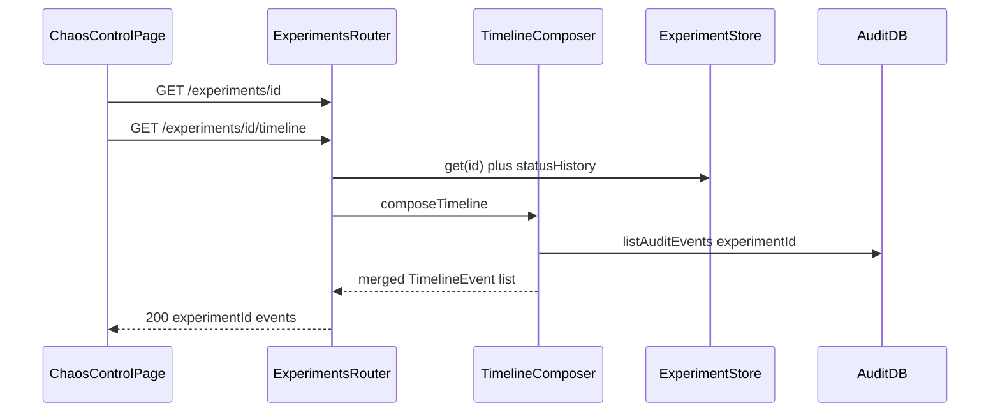

# Implementation Plan — Milestone 7: Experiment Timeline

Scope: only [plan.md](plan.md) Milestone 7 (Experiment Timeline). Recovery metrics and Railway logs are later milestones.

This document is the implementation plan. It does not implement the timeline yet.

**Prerequisite:** [IMPLEMENTATION_MILESTONE_6.md](IMPLEMENTATION_MILESTONE_6.md) must be implemented first. M7 is a **view** on M6’s in-memory experiment envelope plus the durable audit trail. As of this writing, the repo may still look like M5 (Chaos Control polls infrastructure only). Do not invent a parallel experiment API in M7.

## Goal

A chronological **experiment timeline** on `/chaos` that matches the plan.md story:

```text
Experiment EXP-001

10:42:01  Experiment started
10:42:03  Database stopping
10:42:07  Database stopped
10:42:08  Booking attempted
10:42:08  DATABASE_UNAVAILABLE
10:42:08  Booking failed
10:42:19  Database restart initiated
10:42:32  Database recovered
10:42:43  Booking succeeded
10:42:44  Experiment completed
```

The timeline should connect:

```text
Experiment
   ↓
Booking request
   ↓
Audit events
   ↓
Railway service state
   ↓
Recovery
```

MVP checkpoint: after a database-outage run, `/chaos` shows that ordered narrative (or the equivalent while the run is still in flight). `GET /experiments/:id/timeline` is the single source for the list. Raw audit remains on `GET /experiments/:id/events`.

```text
ChaosControlPage
   ↓  GET /experiments/:id            (poll, M6)
   ↓  GET /experiments/:id/timeline   (poll, M7)
Booking API timeline composer
   ↓  experiment.statusHistory        (envelope)
   ↓  listAuditEvents({ experimentId })
Audit Postgres  |  in-memory experiment Map
```


## Key Decisions (flag if you disagree)

- **M6 first** — reuse `GET /experiments/:id`, `GET /experiments/:id/events`, `GET /experiments/current`, and `recordAuditEvent` stamps. No new GraphQL. No localhost self-HTTP.
- **Server-composed timeline** — `GET /experiments/:id/timeline` returns `{ experimentId, events }`. The UI renders the array; it does **not** merge audit + status itself.
- **Two sources, one list**
  - **Envelope steps** from in-memory `statusHistory` on the M6 experiment store. M7 extends `store.update` so every status change appends `{ status, at }` (`at` = ISO datetime). Map those to plan.md labels (see mapping below).
  - **Audit steps** from existing `listAuditEvents({ experimentId })`. Curated types only: `BOOKING_ATTEMPTED`, `DATABASE_UNAVAILABLE`, `BOOKING_FAILED`, `DATABASE_RECOVERED`, `BOOKING_CREATED` (display label: **Booking succeeded**). Omit `REQUEST_RECEIVED` and `VALIDATION_PASSED` from the timeline; they stay on `/events`.
- **No new** `AuditEventType` **values** — M6 deferred `EXPERIMENT_STARTED` and similar. Envelope labels are derived from `statusHistory`, not new audit enum members.
- **Do not persist envelope steps to Postgres in M7** — “Experiment started”, “Database stopping”, etc. live only on the in-process experiment object. The audit DB remains the durable **booking/recovery** trail. After an API restart, envelope lines disappear; audit rows for that `experimentId` can still exist.
- **No Railway GraphQL history** — M5 cards on `/chaos` stay live connectivity/lifecycle. Timeline “Railway service state” means orchestrator steps (`STOPPING_DATABASE`, `DATABASE_DOWN`, `RECOVERING_DATABASE`), not poll deltas. Railway `latestDeployment.status` is not liveness ([IMPLEMENTATION_MILESTONE_5.md](IMPLEMENTATION_MILESTONE_5.md) Known behavior).
- **Merge order** — sort by `timestamp` ascending. Equal timestamps: envelope before audit, then stable `id`. If both envelope `DATABASE_RECOVERED` and audit `DATABASE_RECOVERED` exist, **drop the envelope copy** and keep the audit row (probe-up write is the canonical recovery instant).
- **404 vs partial**
  - In-memory experiment exists → always 200 (history + whatever audit has landed).
  - Map miss after restart, but audit rows exist for that id → 200 **audit-only** timeline (`events` may have no “Experiment started”). Document this.
  - Neither Map nor audit rows → **404** `{ message: "Experiment not found" }` (same as M6 get).
- `statusHistory` **seed** — on `create()`, push `{ status: "CREATED", at: createdAt }`. On start / orchestrator transitions, `update` appends the new status. Do not rewrite past entries.
- **Thin UI on** `/chaos` — timeline panel **below** the M6 status / run button. Heading `Experiment {id}`. Poll `getExperimentTimeline` at the same cadence as experiment status (~1s in-flight, else 3s or pause when terminal). `aria-live="polite"`. Times in `font-mono` (local locale `HH:mm:ss` is fine). No metrics block (M8). No Railway log pane (M9). No new React Router path.
- **HTTP contract in** `@hotel-chaos/shared` — Zod in `packages/shared/src/timeline.ts`. Web still must not depend on `@hotel-chaos/railway-client`.
- **No auth** — same as M5/M6.


### Envelope status → timeline label


| Experiment status (first time it appears in `statusHistory`) | Label                                                              |
| ------------------------------------------------------------ | ------------------------------------------------------------------ |
| `CREATED`                                                    | *(omit from timeline — not “started” yet)*                         |
| `STOPPING_DATABASE`                                          | Experiment started **and** Database stopping — see note            |
| `DATABASE_DOWN`                                              | Database stopped                                                   |
| `GENERATING_FAILURE`                                         | *(omit — booking audit rows cover this)*                           |
| `RECOVERING_DATABASE`                                        | Database restart initiated                                         |
| `DATABASE_RECOVERED`                                         | Database recovered *(omit if audit* `DATABASE_RECOVERED` *exists)* |
| `VERIFYING_RECOVERY`                                         | *(omit — recovery* `BOOKING_CREATED` *covers this)*                |
| `COMPLETED`                                                  | Experiment completed                                               |
| `FAILED`                                                     | Experiment failed                                                  |


**Experiment started:** emit a single envelope event at the timestamp of the first `STOPPING_DATABASE` entry, label `Experiment started`, **then** a second event at the same or that same `at` for `Database stopping` if you prefer two lines as in plan.md. Implementation: two `TimelineEvent`s sharing `statusHistory`’s `STOPPING_DATABASE` `at` — first kind `EXPERIMENT_STARTED`, second `DATABASE_STOPPING`. Sort rule (envelope before audit) keeps them adjacent; give `EXPERIMENT_STARTED` a lower `id` suffix (`…-started` vs `…-stopping`) so started appears first when timestamps are equal.

`FAILED` may include `error` on the experiment DTO (M6); timeline label stays `Experiment failed`. Do not put the error string in every row; the existing status panel still shows `error`.

### Why envelope steps are not audit rows

M6 split **ephemeral envelope** (live `status`) from **durable evidence** (`audit_events.experiment_id`). Exact “Database stopping at T+2s” timestamps live in memory unless you later persist history. M7 adds `statusHistory` so the **live demo** can show plan.md labels without changing the audit enum or adding an `experiments` table. That is enough for an uninterrupted `/chaos` session. It is **not** a past-run archive after API restart.

## Target Structure

```text
chaos-eng-demo/
├── packages/shared/src/
│   ├── timeline.ts            # NEW: TimelineEvent, GET response Zod
│   ├── experiment.ts          # M6; optional: statusHistory on GET experiment
│   └── index.ts               # re-export timeline
├── apps/api/src/
│   ├── experiments/
│   │   ├── store.ts           # M6: append statusHistory on update
│   │   └── timeline.ts        # NEW: compose envelope + curated audit
│   └── routes/
│       └── experiments.ts     # GET /experiments/:id/timeline
├── apps/web/src/
│   ├── lib/api.ts             # getExperimentTimeline
│   └── pages/ChaosControlPage.tsx  # timeline panel
├── IMPLEMENTATION_MILESTONE_7.md   # this file
├── docs/railway.md            # Milestone 7 section when implementing code
└── README.md                  # Milestone 7 section when implementing code
```




## Steps


### 1. Shared HTTP contract (`packages/shared/src/timeline.ts`)

Export Zod schemas and inferred types. Re-export from [packages/shared/src/index.ts](packages/shared/src/index.ts).

```ts
export const timelineEventSourceSchema = z.enum(["envelope", "audit"]);

export const timelineEventKindSchema = z.enum([
  "EXPERIMENT_STARTED",
  "DATABASE_STOPPING",
  "DATABASE_STOPPED",
  "BOOKING_ATTEMPTED",
  "DATABASE_UNAVAILABLE",
  "BOOKING_FAILED",
  "DATABASE_RESTART_INITIATED",
  "DATABASE_RECOVERED",
  "BOOKING_SUCCEEDED",
  "EXPERIMENT_COMPLETED",
  "EXPERIMENT_FAILED",
]);

export const timelineEventSchema = z.object({
  id: z.string(),
  source: timelineEventSourceSchema,
  kind: timelineEventKindSchema,
  label: z.string(),
  timestamp: z.string().datetime(),
  requestId: z.string().uuid().nullable(),
  bookingId: z.string().nullable(),
  eventType: z.string().nullable(),
});

export const experimentTimelineResponseSchema = z.object({
  experimentId: z.string(),
  events: z.array(timelineEventSchema),
});
```

`eventType` is the audit `AuditEventType` when `source === "audit"`, else `null`. Envelope events use `id` like `{experimentId}-STOPPING_DATABASE` / `{experimentId}-EXPERIMENT_STARTED`. Audit events reuse `eventId`.

Optional M6 follow-on: add `statusHistory` to `experimentSchema` if the UI ever needs it; **not required** if only `/timeline` is consumed.

Do **not** import `@hotel-chaos/railway-client` from shared.

### 2. `statusHistory` on the experiment store

In [apps/api/src/experiments/store.ts](apps/api/src/experiments/store.ts) (M6):

- Extend the in-memory record with `statusHistory: { status: ExperimentStatus; at: string }[]`.
- `create`: `[{ status: "CREATED", at: createdAt }]`.
- `update`: if `patch.status` is set and differs from current, append `{ status: patch.status, at: new updatedAt }`.

Do not persist the array. Do not add an `experiments` table.

### 3. Timeline composer

**[apps/api/src/experiments/timeline.ts](apps/api/src/experiments/timeline.ts)**

`composeTimeline(experimentId): Promise<ExperimentTimelineResponse | null>`

1. `get(experimentId)` from the store (may be undefined).
2. `listAuditEvents({ experimentId })`.
3. If no store row and audit list is empty → `null` (route 404s).
4. Build envelope events from `statusHistory` using the mapping table (skip `CREATED`, `GENERATING_FAILURE`, `VERIFYING_RECOVERY`; split `STOPPING_DATABASE` into started + stopping).
5. Map curated audit rows to timeline events (`BOOKING_CREATED` → kind `BOOKING_SUCCEEDED`, label `Booking succeeded`; `DATABASE_UNAVAILABLE` label stays `DATABASE_UNAVAILABLE`).
6. If any audit event has `eventType === "DATABASE_RECOVERED"`, drop envelope events with kind `DATABASE_RECOVERED`.
7. Sort as specified. Return `{ experimentId, events }`.

Keep GraphQL out of this file.

### 4. Route

In [apps/api/src/routes/experiments.ts](apps/api/src/routes/experiments.ts):


| Method | Path                        | Behavior                                                                  |
| ------ | --------------------------- | ------------------------------------------------------------------------- |
| `GET`  | `/experiments/:id/timeline` | `composeTimeline`. **200** `experimentTimelineResponseSchema` or **404**. |


Register **before** `GET /experiments/:id` only if Express would otherwise treat `timeline` as an id — prefer a nested path `/:id/timeline` on the same router so `:id` is the experiment id. Order relative to `/experiments/current` stays: `current` first, then `/:id/timeline` and `/:id/events` and `/:id`.

### 5. Web API helper and Chaos Control panel

Extend [apps/web/src/lib/api.ts](apps/web/src/lib/api.ts):

```ts
getExperimentTimeline(id: string): Promise<ExperimentTimelineResponse>
```

Import types from `@hotel-chaos/shared`. Reuse `requestJson`.

**[apps/web/src/pages/ChaosControlPage.tsx](apps/web/src/pages/ChaosControlPage.tsx)**

Follow existing patterns: named `const` export, Tailwind only, `useQuery`, `handle*` handlers, `useId`, `aria-live`.

- When an experiment `id` is known (M6 run or `getCurrentExperiment`), query timeline with `refetchInterval` aligned to experiment polling.
- Render an ordered list: time + label. Optional `font-mono text-xs` `bookingId` / `requestId` on audit-sourced rows.
- Empty list while `CREATED` and not started: hide the panel or show “No timeline yet”.
- Failed query: reuse the page’s error + retry pattern; do not blank the infrastructure cards.

No new route. Booking pages unchanged.

### 6. Documentation (when implementing M7 **code**)

Not part of writing this plan file.

**[docs/railway.md](docs/railway.md)** — Milestone 7: `/timeline` vs `/events`; envelope vs audit; restart loses envelope lines.

**[README.md](README.md)** — Milestone 7 section linking this file; `/chaos` timeline; curl sketch.

## Verification Checklist (Milestone 7 done when)

- [x] M6 acceptance still holds (`COMPLETED` run, `/events` includes outage + recovery audit types)
- [x] `npm run typecheck` passes all workspaces
- [x] `GET /experiments/:id/timeline` during/after a run includes labels equivalent to plan.md (started, stopping, stopped, booking attempted, `DATABASE_UNAVAILABLE`, booking failed, restart initiated, recovered, booking succeeded, completed)
- [x] Timeline omits `REQUEST_RECEIVED` and `VALIDATION_PASSED`
- [x] `GET /experiments/:id/events` still returns the full audit list
- [x] Duplicate recovery: at most one “Database recovered” line when audit `DATABASE_RECOVERED` exists
- [x] `/chaos` shows the list updating while the experiment is in flight
- [x] After API process restart: `/timeline` for an old `EXP-` is audit-only if audit rows exist, or 404 if not; documented
- [x] No GraphQL strings under `apps/api/src/routes` or `apps/web`
- [x] `apps/web/package.json` still does not list `@hotel-chaos/railway-client`


### Local commands

```bash
npm run dev
# Web: http://localhost:5173/chaos
# API: http://localhost:3001

API=http://localhost:3001
EXP=EXP-1000   # use a real id from POST /experiments after M6

curl -s "$API/experiments/$EXP/timeline" | jq '.events[] | {timestamp, kind, label, source}'
curl -s "$API/experiments/$EXP/events" | jq '.events[] | {eventType}'
```

Expect the same 1–3 minute Railway window as M6 before the list is complete.

## Explicitly Out of Scope (later milestones)

- Recovery metrics (downtime, recovery time, failure rate) (M8)
- Railway logs correlation UI (M9)
- Persisted `experiments` table / writing envelope steps to `audit_events`
- New `AuditEventType` values
- Multiple simultaneous experiments
- Auth on `/experiments`
- Changing `toLifecycleStatus` in railway-client
- Timeline on booking details page
- Rollback, ephemeral environments, multi-environment provisioning

