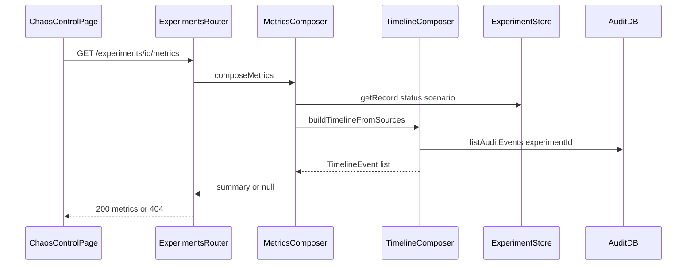

# Implementation Plan — Milestone 8: Recovery Metrics

Scope: only [plan.md](plan.md) Milestone 8 (Recovery Metrics). Railway logs are Milestone 9.

This document is the implementation plan. It does not implement metrics yet.

**Prerequisite:** [IMPLEMENTATION_MILESTONE_7.md](IMPLEMENTATION_MILESTONE_7.md) must be implemented first. M8 is a **view** on M7’s composed timeline (envelope `statusHistory` + curated audit) plus envelope `status` / `scenario` when the in-memory experiment exists. Do not invent a second merge of audit + history in the UI, and do not add GraphQL or an `experiments` table.

M7 **code** is already in this repo (`GET /experiments/:id/timeline`, `composeTimeline`, `/chaos` timeline panel). README and `docs/railway.md` still lack Milestone 7 sections; add those when implementing M8 **code** (see step 6).

## Goal

A small **recovery-metrics** block on `/chaos` that matches the plan.md story:

```text
Experiment: EXP-001
Scenario: Database outage

Requests: 2
Successful: 1
Failed: 1
Failure rate: 50%

Database downtime: 31s
Recovery time: 18s

Result: RECOVERED
```

The 31s / 18s figures in plan.md are illustrative. Live values come from timestamp deltas (see formulas). A completed orchestrator run with no extra human bookings should show **Requests 2 / Successful 1 / Failed 1 / Failure rate 50% / Result RECOVERED**.

MVP checkpoint: after a database-outage run, `/chaos` shows that summary (or the equivalent with `null` durations while the run is still in flight). `GET /experiments/:id/metrics` is the single source. The UI renders the object; it does **not** compute rates or durations from the timeline array.

```text
ChaosControlPage
   ↓  GET /experiments/:id            (poll, M6)
   ↓  GET /experiments/:id/timeline   (poll, M7)
   ↓  GET /experiments/:id/metrics    (poll, M8)
Booking API metrics composer
   ↓  composeTimeline / same sources
   ↓  envelope status + scenario (if Map hit)
Audit Postgres  |  in-memory experiment Map
```

## Key Decisions (flag if you disagree)

- **M7 first** — reuse `composeTimeline` / `buildTimelineFromSources` in [apps/api/src/experiments/timeline.ts](apps/api/src/experiments/timeline.ts). Read `getRecord` only for `status` and `scenario`. No new GraphQL. No localhost self-HTTP. No new `AuditEventType` values.
- **Dedicated endpoint** — `GET /experiments/:id/metrics` returns the summary object. Do **not** bolt fields onto `/timeline` or `GET /experiments/:id`. See [Dedicated endpoint](#dedicated-endpoint-why-not-fold-metrics-into-an-existing-get).
- **Server-composed metrics** — the UI polls `getExperimentMetrics` and renders. Formulas (unique `requestId`s, downtime fallback, `UNKNOWN` after restart) live in the API.
- **404 vs partial** — same rule as M7 timeline. See [404 vs partial](#404-vs-partial).
- **Request counting from timeline kinds, not orchestrator constants.** Unique `requestId`s with kind `BOOKING_ATTEMPTED` = total. `BOOKING_SUCCEEDED` = successful. `BOOKING_FAILED` = failed. Extra human `POST /bookings` during the in-flight window (M6 stamps `experimentId`) **do** count. `DATABASE_RECOVERED` has its own `requestId` and no `BOOKING_ATTEMPTED`, so it does not inflate totals.
- **Formulas** — seconds = nearest integer (`Math.round(ms / 1000)`); missing endpoint or negative delta → `null`. See [Formulas](#formulas).
- **`result` is a metrics display enum, not a new experiment status.** `RECOVERED` | `FAILED` | `IN_PROGRESS` | `UNKNOWN`. Envelope `COMPLETED` → `RECOVERED`; `FAILED` → `FAILED`; otherwise `IN_PROGRESS`. Audit-only (no envelope): `UNKNOWN`. `GET /experiments/:id` still returns `status: "COMPLETED"`, not `RECOVERED`.
- **`scenario`** — from envelope when present, else `"database-outage"` (only MVP scenario). UI may display “Database outage”.
- **Thin UI on `/chaos`** — metrics panel **below** the M7 timeline (plan.md DoD order: timeline, then recovery metrics). Same poll cadence as timeline (~1s in-flight, pause when terminal). `aria-live="polite"`. Durations as `31s`; `null` as an em dash. No new React Router path. Booking pages unchanged. No Railway log pane (M9).
- **HTTP contract in `@hotel-chaos/shared`** — Zod in `packages/shared/src/metrics.ts`. Web still must not depend on `@hotel-chaos/railway-client`.
- **Pure composer + smoke file** — export `buildMetricsFromTimeline` for [apps/api/src/experiments/metrics.smoke.ts](apps/api/src/experiments/metrics.smoke.ts), next to [apps/api/src/experiments/timeline.smoke.ts](apps/api/src/experiments/timeline.smoke.ts).
- **Do not persist metrics** — no `experiments` table, no metrics column. Same ephemeral-envelope vs durable-audit split as M6/M7.
- **No auth** — same as M5–M7.

### Dedicated endpoint (why not fold metrics into an existing GET)

Today the experiment HTTP surface is already split by job:

- `GET /experiments/:id` — live **envelope** (`status`, `error`, ids). Map-only; 404 after restart.
- `GET /experiments/:id/events` — raw **audit list**.
- `GET /experiments/:id/timeline` — composed **narrative** (`{ experimentId, events[] }`).

Metrics are a fourth job: a **summary object** (counts, percent, durations, `result`), not a status DTO and not an event list.

**Chosen:** `GET /experiments/:id/metrics` — same nesting as `/timeline`, same 404-vs-partial rule, own Zod schema in shared. The UI polls it and renders the panel; it does not derive rates from the timeline array.

Rejected alternatives:

- **Add fields to `GET /experiments/:id`.** That DTO is the ephemeral run object. Mixing derived analytics into it (a) changes `experimentSchema` for every poller, (b) cannot return partial metrics after restart because that route already 404s on Map miss, (c) would put `result: RECOVERED` next to `status: COMPLETED` on the same resource and invite confusion.
- **Add a `metrics` object on `GET /experiments/:id/timeline`.** Timeline is an event list. A summary is a different shape and a different `/chaos` panel. Coupling them means every timeline tweak or poll also ships metrics, and M9 logs would be tempted onto the same blob next.
- **Compute in the browser from `/timeline`.** Breaks the M7 rule that the UI renders and does not merge/calculate. Formulas would be duplicated and easy to drift from the API.

The composer **may still call** `composeTimeline` / `buildTimelineFromSources` internally so there is one merge of envelope + audit. Dedicated endpoint is about the **HTTP contract**, not about avoiding reuse.

Register `/experiments/:id/metrics` beside `/timeline` (before `GET /experiments/:id`) so `metrics` is not parsed as an id.

### 404 vs partial

M6 split experiment data into two layers. That split is why `/timeline` and `/metrics` cannot use a single “does this experiment exist?” check.

- **Envelope** (in-memory `Map`): live `status`, `statusHistory`, `scenario`. **Lost on API process restart.**
- **Audit trail** (`audit_events.experiment_id`): booking attempts, failures, `DATABASE_RECOVERED`, `BOOKING_CREATED`. **Survives restart.**

`GET /experiments/:id` and `GET /experiments/:id/events` **404 if the Map misses**, even when audit rows still exist. That is correct for “give me the live run object.” It is too strict for a **view** that can still answer from audit.

M8 uses the same three outcomes as M7 `/timeline`:

1. **Envelope present** (normal demo, no restart) → **200.** Metrics can compute downtime, recovery time, and `result: RECOVERED` from envelope `COMPLETED`. Audit rows may still be catching up while the run is in flight — durations stay `null` until both timestamps exist.
2. **Envelope gone, audit rows exist** (API restarted, caller still has `EXP-1000`) → **200 partial**, not 404. Request counts / failure rate still work. `recoveryTimeSeconds` is `null` (restart-initiated is envelope-only). `databaseDowntimeSeconds` may use the `DATABASE_UNAVAILABLE` → `DATABASE_RECOVERED` fallback. `result` is `UNKNOWN`.
3. **Neither envelope nor audit** → **404** `{ message: "Experiment not found" }`. Composer returns `null`. Do not invent an empty metrics object for a garbage id.

**Partial means HTTP 200 with holes (`null` durations, `UNKNOWN` result) — not a 206, and not a 404.** A 404 would hide durable evidence that the experiment did run.

The `/chaos` UI usually will not hit case 2 by itself: after refresh, `GET /experiments/current` 404s and the page loses the tracked id. Case 2 matters for **curl / replay of a known `EXP-` id** and for documenting restart behavior. Case 1 during the live run is the demo path.

### Formulas


| Field | Rule |
| ----- | ---- |
| `totalRequests` | Unique `requestId` on timeline events with kind `BOOKING_ATTEMPTED` |
| `successfulRequests` | Unique `requestId` on kind `BOOKING_SUCCEEDED` |
| `failedRequests` | Unique `requestId` on kind `BOOKING_FAILED` |
| `failureRatePercent` | `Math.round((failedRequests / totalRequests) * 100)` if `totalRequests > 0`, else `null` |
| `databaseDowntimeSeconds` | Prefer first `DATABASE_STOPPED` timestamp → first `DATABASE_RECOVERED` timestamp. Fallback if no stopped line: first `DATABASE_UNAVAILABLE` → first `DATABASE_RECOVERED`. Else `null`. |
| `recoveryTimeSeconds` | First `DATABASE_RESTART_INITIATED` → first `DATABASE_RECOVERED`. No fallback. Else `null`. |
| `result` | Envelope `COMPLETED` → `RECOVERED`; envelope `FAILED` → `FAILED`; envelope present otherwise → `IN_PROGRESS`; no envelope → `UNKNOWN` |


Duration helper: `Math.round((Date.parse(end) - Date.parse(start)) / 1000)`. If either timestamp is missing or the delta is negative, return `null`.

Open intervals while the run is in flight stay `null` (UI shows an em dash). Do **not** live-tick elapsed time from `Date.now()`.

A request should not count as both successful and failed. If both kinds exist for the same `requestId` (should not happen on the booking path), count it as successful only.

### Why `result` is not `COMPLETED`

plan.md’s demo line is `Result: RECOVERED`. Experiment **status** stays the M6 enum (`COMPLETED` / `FAILED` / …) on `GET /experiments/:id` and on the existing status panel. Metrics `result` is a display enum for the summary card only.

## Target Structure

```text
chaos-eng-demo/
├── packages/shared/src/
│   ├── metrics.ts             # NEW: result enum, GET response Zod
│   ├── timeline.ts            # M7; reuse kinds for counting
│   └── index.ts               # re-export metrics
├── apps/api/src/
│   ├── experiments/
│   │   ├── timeline.ts        # M7; composer reuses this
│   │   ├── metrics.ts         # NEW: buildMetricsFromTimeline + composeMetrics
│   │   └── metrics.smoke.ts   # NEW: fixture assertions
│   └── routes/
│       └── experiments.ts     # GET /experiments/:id/metrics
├── apps/web/src/
│   ├── lib/api.ts             # getExperimentMetrics
│   └── pages/ChaosControlPage.tsx  # metrics panel below timeline
├── IMPLEMENTATION_MILESTONE_8.md   # this file
├── docs/railway.md            # Milestone 8 (and missing M7) when implementing code
└── README.md                  # Milestone 8 (and missing M7) when implementing code
```



## Steps

### 1. Shared HTTP contract (`packages/shared/src/metrics.ts`)

Export Zod schemas and inferred types. Re-export from [packages/shared/src/index.ts](packages/shared/src/index.ts).

```ts
export const experimentMetricsResultSchema = z.enum([
  "RECOVERED",
  "FAILED",
  "IN_PROGRESS",
  "UNKNOWN",
]);

export const experimentMetricsResponseSchema = z.object({
  experimentId: z.string(),
  scenario: experimentScenarioSchema,
  totalRequests: z.number().int().nonnegative(),
  successfulRequests: z.number().int().nonnegative(),
  failedRequests: z.number().int().nonnegative(),
  failureRatePercent: z.number().int().min(0).max(100).nullable(),
  databaseDowntimeSeconds: z.number().int().nonnegative().nullable(),
  recoveryTimeSeconds: z.number().int().nonnegative().nullable(),
  result: experimentMetricsResultSchema,
});
```

Import `experimentScenarioSchema` from [packages/shared/src/experiment.ts](packages/shared/src/experiment.ts). Do **not** import `@hotel-chaos/railway-client` from shared.

Do not add these fields to `experimentSchema` or `experimentTimelineResponseSchema`.

### 2. Metrics composer

**[apps/api/src/experiments/metrics.ts](apps/api/src/experiments/metrics.ts)**

`buildMetricsFromTimeline(input): ExperimentMetricsResponse | null` — pure; used by smoke.

Input:

- `experimentId`
- timeline from `buildTimelineFromSources` (or `null`)
- optional envelope `{ status, scenario }` from `getRecord`

Behavior:

1. If timeline is `null` → return `null` (same emptiness rule as M7: no envelope history and no audit rows).
2. Count unique `requestId`s by kind as in the formulas table (`requestId` is nullable on envelope rows; skip nulls).
3. Compute durations from first matching timeline timestamps.
4. Set `result` and `scenario` from envelope when present; else `result: "UNKNOWN"` and `scenario: "database-outage"`.
5. Return the summary object.

`composeMetrics(experimentId): Promise<ExperimentMetricsResponse | null>`:

1. `getRecord(experimentId)` (may be undefined).
2. `listAuditEvents({ experimentId })` **or** call `composeTimeline` / `buildTimelineFromSources` so the merge stays in one place.
3. Return `buildMetricsFromTimeline(...)`.

Keep GraphQL out of this file.

### 3. Route

In [apps/api/src/routes/experiments.ts](apps/api/src/routes/experiments.ts):


| Method | Path                       | Behavior                                                                 |
| ------ | -------------------------- | ------------------------------------------------------------------------ |
| `GET`  | `/experiments/:id/metrics` | `composeMetrics`. **200** `experimentMetricsResponseSchema` or **404**. |


Register with the other nested GETs: `current` first, then `/:id/timeline`, `/:id/metrics`, `/:id/events`, then `/:id`.

### 4. Web API helper and Chaos Control panel

Extend [apps/web/src/lib/api.ts](apps/web/src/lib/api.ts):

```ts
getExperimentMetrics(id: string): Promise<ExperimentMetricsResponse>
```

Import types from `@hotel-chaos/shared`. Reuse `requestJson`.

**[apps/web/src/pages/ChaosControlPage.tsx](apps/web/src/pages/ChaosControlPage.tsx)**

Follow existing patterns: named `const` export, Tailwind only, `useQuery`, `handle*` handlers, `useId`, `aria-live`.

- When `trackedExperimentId` is set, query metrics with `refetchInterval` aligned to experiment / timeline polling (`experimentPollIntervalMs`).
- Render a panel **below** the timeline section. Heading can repeat `Experiment {id}` or use “Recovery metrics”.
- Show scenario, request counts, failure rate, downtime, recovery time, and result. `null` numbers → `—`. Percents → `50%`. Seconds → `31s`.
- Result tone: `RECOVERED` emerald, `FAILED` red, `IN_PROGRESS` amber, `UNKNOWN` slate — same dot + text pattern as experiment status.
- Failed query: error + retry; do not blank the timeline or infrastructure cards.
- Empty / not-yet-started (`CREATED`, zeros): still show the block with zeros and `IN_PROGRESS`, or “No metrics yet” if you prefer to match “No timeline yet”. Pick one and keep it consistent.

No new route. Booking pages unchanged.

### 5. Smoke script

**[apps/api/src/experiments/metrics.smoke.ts](apps/api/src/experiments/metrics.smoke.ts)**

Reuse M7 fixture timestamps from [apps/api/src/experiments/timeline.smoke.ts](apps/api/src/experiments/timeline.smoke.ts), but include a **complete** happy-path audit set (the current timeline smoke omits `BOOKING_FAILED` and the recovery `BOOKING_ATTEMPTED`):

- Failure request: `BOOKING_ATTEMPTED` + `DATABASE_UNAVAILABLE` + `BOOKING_FAILED`
- Recovery request: `BOOKING_ATTEMPTED` + `BOOKING_CREATED`
- `DATABASE_RECOVERED` (audit) at `10:42:32.500Z`
- Envelope `DATABASE_DOWN` at `10:42:07.000Z`, `RECOVERING_DATABASE` at `10:42:19.000Z`, `COMPLETED`

Assert:

- Happy path: `totalRequests === 2`, `successfulRequests === 1`, `failedRequests === 1`, `failureRatePercent === 50`, `result === "RECOVERED"`
- `databaseDowntimeSeconds === 26` (07.000 → 32.500 → 25.5s → 26)
- `recoveryTimeSeconds === 14` (19.000 → 32.500 → 13.5s → 14)
- Audit-only (no envelope): counts still 2/1/1; `recoveryTimeSeconds === null`; `result === "UNKNOWN"`; downtime uses UNAVAILABLE → RECOVERED fallback
- Extra human `BOOKING_ATTEMPTED` + `BOOKING_FAILED` increments totals and failed
- Empty sources → `null`

Do not assert plan.md’s illustrative 31s / 18s.

### 6. Documentation (when implementing M8 **code**)

Not part of writing this plan file.

**[docs/railway.md](docs/railway.md)** — Milestone 8: `/metrics` vs `/timeline` vs `/events`; 404 vs partial; `result` vs experiment `status`; duration formulas. If Milestone 7 is still missing, add it too (`/timeline` vs `/events`; envelope vs audit; restart loses envelope lines).

**[README.md](README.md)** — Milestone 8 section linking this file; `/chaos` metrics panel; curl sketch. Add the missing Milestone 7 section if still absent.

## Verification Checklist (Milestone 8 done when)

- [ ] M6/M7 acceptance still holds (`COMPLETED` run, `/timeline` labels, `/events` full audit list)
- [ ] `npm run typecheck` passes all workspaces
- [ ] `GET /experiments/:id/metrics` after a completed run: 2 / 1 / 1 / 50% / `result: RECOVERED`, non-null downtime and recovery seconds
- [ ] Mid-run: 200 with `result: IN_PROGRESS` and `null` durations until both timestamps exist
- [ ] Extra `POST /bookings` during the window changes request counts
- [ ] After API process restart: `/metrics` for an old `EXP-` is 200 partial if audit rows exist (counts survive; `recoveryTimeSeconds` null; `result: UNKNOWN`), or 404 if not; documented
- [ ] `GET /experiments/:id` still 404s after restart (unchanged M6); `status` remains `COMPLETED` not `RECOVERED` while the process is up
- [ ] `/chaos` shows the metrics block below the timeline; poll updates while in flight
- [ ] Unknown id → 404 `{ message: "Experiment not found" }`
- [ ] No GraphQL strings under `apps/api/src/routes` or `apps/web`
- [ ] `apps/web/package.json` still does not list `@hotel-chaos/railway-client`

### Local commands

```bash
npm run dev
# Web: http://localhost:5173/chaos
# API: http://localhost:3001

API=http://localhost:3001
EXP=EXP-1000   # use a real id from POST /experiments after M6

curl -s "$API/experiments/$EXP/metrics" | jq .
curl -s "$API/experiments/$EXP/timeline" | jq '.events[] | {timestamp, kind, label, source}'
```

Expect the same 1–3 minute Railway window as M6 before the summary is complete (`result: RECOVERED`, both durations filled).

Optional smoke (after code exists):

```bash
npx tsx apps/api/src/experiments/metrics.smoke.ts
```

## Explicitly Out of Scope (later milestones)

- Railway logs correlation UI (M9)
- Persisted `experiments` table / writing envelope steps or metrics to Postgres
- Advanced metrics (p99, error budgets, multi-run history)
- Auth on `/experiments`
- Computing metrics in the browser
- Changing orchestrator booking count or experiment statuses
- New `AuditEventType` values
- Timeline or metrics on the booking details page
- Changing `toLifecycleStatus` in railway-client
- Multiple simultaneous experiments
- Rollback, ephemeral environments, multi-environment provisioning
